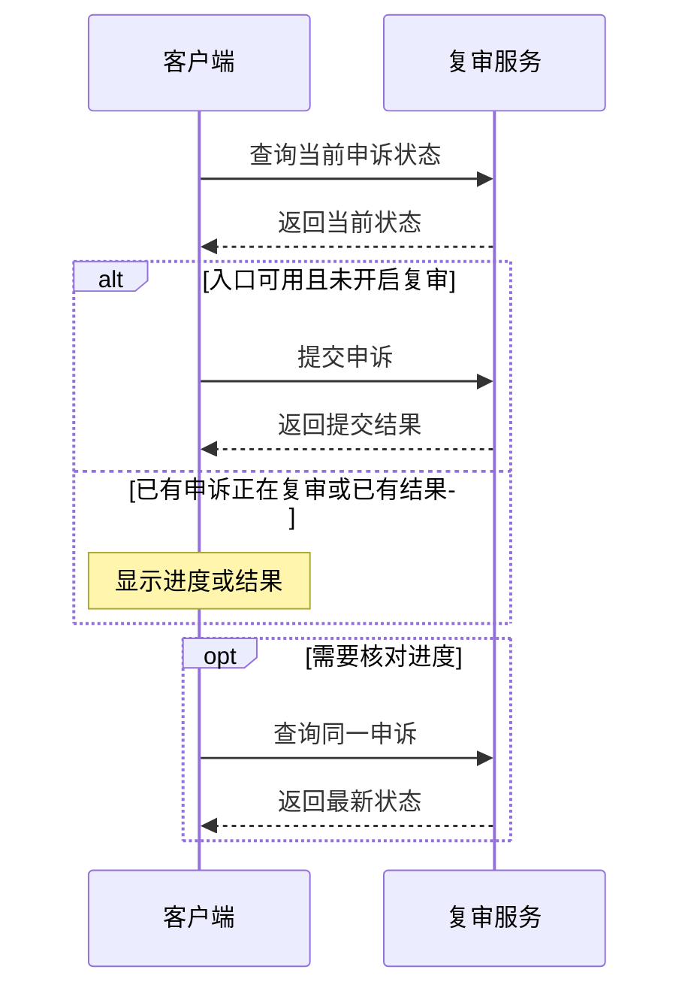
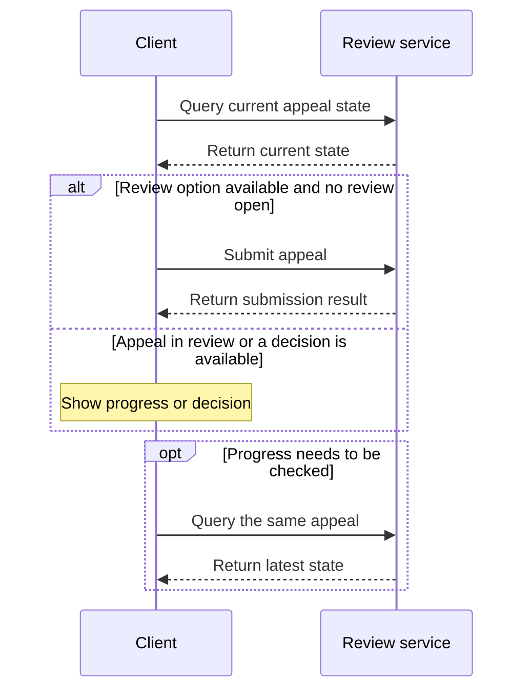

# WhatsApp 账号申诉技术分析 · Technical Analysis of WhatsApp Account Appeals

[首页](../README.md#zh) · [Wiki home](../README.md#en) · [中文](#zh) · [English](#en) · [Telegram: @ttjjda](https://t.me/ttjjda)

<a id="zh"></a>

## 中文

### 封禁识别与复审入口

账号封禁状态以账号登录回执为准。网页请求被拒绝时，仍需查看账号登录结果。本地对照中，同一测试账号收到不同的封禁回执后，分别显示了登录失败提示和复审页面。客户端显示「请求复审」时，用户可以从该入口发起申诉。 [WhatsApp 帮助中心](https://faq.whatsapp.com/465883178708358/?locale=zh_CN)

### 申诉说明、上下文与设备资料

提交将用户说明和可核实的应用、设备诊断关联到当前账号。标题用于概括这项请求，用户填写的内容通过 `description` 提交。

| 信息 | 含义 |
| --- | --- |
| 展示标题 | 界面或文档可使用「请求复审账号封禁」概括请求。 |
| 申诉说明 `description` | 用户希望 WhatsApp 核实的情况。示例为「登录时收到账号受限提示，页面显示可以请求复审。请核实本次限制。」 |

#### 诊断上下文

Android 申诉诊断包含描述复审场景和客户端环境的字符串字段。各字段取自本次申诉流程或客户端配置。

| 字段 | 含义 | 来源 |
| --- | --- | --- |
| `Context` | 说明这组诊断用于账号封禁复审。 | 生成诊断时使用的业务场景。 |
| `ban_appeal_ui_origin` | 说明从哪类客户端场景进入复审。 | Android 打开复审页面时对应的入口。 |
| `useragent` | 描述应用版本和设备环境。 | 客户端根据应用版本、系统版本、制造商和型号等资料生成。 |
| `LC` | 应用当前地区设置中的国家或地区。 | Android 应用资源配置。 |
| `LG` | 应用当前地区设置中的语言。 | Android 应用资源配置。 |

#### 设备参数

应用诊断中的 `Description` 表示应用版本。以下设备参数描述本次提交关联的客户端环境。

| 设备参数 | 含义 |
| --- | --- |
| `Manufacturer` | 设备制造商。 |
| `Model` | Android 报告的设备型号。 |
| `Device` | Android 记录的设备代号。 |
| `OS` | Android 系统版本。 |
| `CPU ABI` | 设备首选的应用二进制接口。 |

这些参数均为字符串。Android 从设备读取 `CPU ABI`。Web 提交时，绑定设备资料中有可核对的值才附带该字段。

注册时保存的资料可以用来核对应用版本、设备型号等相对稳定的信息。需要反映申诉时状态的诊断，应以当时可核实的资料为依据。提交和后续查询应对应同一账号的同一申诉，才能把返回状态归到正确的请求上。

### 提交与状态流转

在复现的客户端路径中，打开复审页面会先查询当前账号的申诉状态。提交操作可能开启复审，后续查询用于跟踪同一申诉的进度和最终结果。



| 查询状态 | 对应行为 |
| --- | --- |
| 未开启复审 | 当前查询未找到已开启的复审。发起申诉仍需可用的复审入口。 |
| 复审中 | 请求已受理，可以查询复审进度。 |
| 已解封 | WhatsApp 已解除账号封禁。 |
| 维持封禁 | WhatsApp 审核后维持原决定。 |

#### 复审中状态响应片段

以下片段根据已保存的状态查询记录整理，保留其中确认的状态字段。该次查询的 HTTP 状态码为 `200`。

```json
{
  "data": {
    "whatsapp_support_ban_appeal_status": {
      "status": "IN_REVIEW"
    }
  }
}
```

`IN_REVIEW` 表示申诉已受理，正在等待复审结果。

#### 解封状态响应示例

以下是一次申诉状态查询的服务器响应，HTTP 状态码为 `200`。

```json
{
  "data": {
    "whatsapp_support_ban_appeal_status": {
      "status": "UNBANNED",
      "reason": null,
      "reason_url": null
    }
  },
  "extensions": {
    "is_final": true
  }
}
```

该响应中的 `status` 为 `UNBANNED`，表示账号已解封。响应中的 `extensions.is_final` 为 `true`。

### 响应异常与重复提交

是否可以重试取决于失败发生在哪一步。提交前的准备失败可以在排除原因后再尝试。请求发出后如果超时、断开连接或响应无法判读，服务端可能已经收到申请。此时将结果标为待确认，通过查询同一申诉核对进度，避免产生重复申请。

| 观察到的情况 | 当前能确认什么 | 对应处理 |
| --- | --- | --- |
| 提交准备失败 | 这次申诉尚未发送。 | 排除准备阶段的问题后可再次尝试。 |
| 提交后丢失响应或无法解析 | 这次请求是否受理仍待确认。 | 查询同一申诉，等待明确状态。 |
| 收到复审中状态 | 申请已进入复审。 | 查看已有请求的进度。 |

### 验证结果与评估口径

本地复现中，首次查询显示未开启复审，提交后页面显示复审中，再次查询确认了这一状态。这组观察用于检查客户端能否走完提交和查询流程。实际服务的受理依据则来自 WhatsApp 的回执。一次实际申诉收到受理回执，后续查询先显示复审中，再返回上述解封状态。

受理比例和解封比例需要分别评估。受理比例以实际提交的去重申诉为基础，结果待确认的请求单独记录。解封比例以已完成复审的申诉为基础，等待审核的请求仍计为复审中。

是否解除封禁由 WhatsApp 的最终审核结果决定。

<a id="en"></a>

## English

### Ban detection and review eligibility

The account login response establishes whether a ban blocked login. If a web request is denied, check the account login result. In a local comparison, different ban responses for the same test account produced a login failure prompt and a review page. When the client offers “Request review,” the user can open an appeal from that screen. [WhatsApp Help Center](https://faq.whatsapp.com/465883178708358/?locale=en_US)

### Appeal description, context, and device information

The submission associates the user’s explanation and verifiable application and device diagnostics with the current account. A title summarizes the request for display, and `description` carries the user’s explanation in the submission.

| Information | Meaning |
| --- | --- |
| Display title | An interface or document can summarize the request as “Request a review of an account ban.” |
| Appeal explanation `description` | What the user wants WhatsApp to review. An example is “I saw an account restriction when I tried to sign in, and the app offered a review. Please review the restriction.” |

#### Diagnostic context

Android appeal diagnostics include string fields that describe the review context and the client environment. The values come from the current appeal flow or the client configuration.

| Field | Meaning | Source |
| --- | --- | --- |
| `Context` | Identifies the diagnostics as part of an account ban review. | The context in which the client generates the diagnostics. |
| `ban_appeal_ui_origin` | Identifies the client scenario that led to the review page. | The entry path Android used to open the review page. |
| `useragent` | Describes the application version and device environment. | The client builds it from details such as application version, OS version, manufacturer, and model. |
| `LC` | The country or region in the app’s current locale. | The Android app resource configuration. |
| `LG` | The language in the app’s current locale. | The Android app resource configuration. |

#### Device parameters

In the application diagnostics, `Description` holds the application version. The device parameters below describe the client environment associated with the submission.

| Device parameter | Meaning |
| --- | --- |
| `Manufacturer` | The device manufacturer. |
| `Model` | The device model reported by Android. |
| `Device` | The device codename recorded by Android. |
| `OS` | The Android release version. |
| `CPU ABI` | The device’s preferred application binary interface. |

These parameters are strings. Android reads `CPU ABI` from the device. A Web submission includes this field when its value can be verified in the linked device records.

Registration records can help verify relatively stable details such as the application version and device model. Diagnostics that describe conditions at the time of appeal depend on information that can be verified at that point. The submission and later queries refer to the same appeal for the same account so the returned state can be attributed to the right request.

### Submission and review states

In the reproduced client path, opening the review page first triggered a status query for the current account. Submission can open a review. Later queries track the progress and final outcome of the same appeal.



| Query state | Behavior |
| --- | --- |
| No review open | The query found no open review. Submission still requires an available review option. |
| In review | The request has been accepted and its progress can be checked. |
| Ban lifted | WhatsApp has lifted the account ban. |
| Ban upheld | WhatsApp reviewed the appeal and kept its original decision. |

#### In-review response fragment

The following fragment is reconstructed from a saved status query and includes the confirmed status field. The query returned HTTP status `200`.

```json
{
  "data": {
    "whatsapp_support_ban_appeal_status": {
      "status": "IN_REVIEW"
    }
  }
}
```

`IN_REVIEW` indicates that the appeal was accepted and is awaiting a review decision.

#### Example response for a lifted ban

The following server response came from an appeal status query with HTTP status `200`.

```json
{
  "data": {
    "whatsapp_support_ban_appeal_status": {
      "status": "UNBANNED",
      "reason": null,
      "reason_url": null
    }
  },
  "extensions": {
    "is_final": true
  }
}
```

The `UNBANNED` status indicates that the account ban was lifted. The response sets `extensions.is_final` to `true`.

### Response failures and duplicate submissions

Whether another attempt is appropriate depends on when the failure happened. A preparation failure can be retried once its cause is resolved. If a request times out, the connection drops, or the response cannot be read after the request was sent, the server may already have received it. The implementation records the result as unconfirmed. A separate query for the same appeal can establish its status and help avoid a duplicate submission.

| Observation | What it establishes | Next action |
| --- | --- | --- |
| Submission preparation failed | This appeal attempt has yet to be sent. | Resolve the preparation problem before another attempt. |
| The submission response was lost or could not be parsed | Acceptance remains unconfirmed. | Query the same appeal and wait for a definite state. |
| The returned state is in review | The request entered review. | Check the progress of the existing appeal. |

### Validation and evaluation

In the local reproduction, the first query showed no open review, the client displayed a review in progress after submission, and a later query confirmed that state. These observations check whether the client can complete submission and query the result. An acceptance response from WhatsApp establishes acceptance by the live service. One live appeal received an acceptance response. Later queries showed it in review and then returned the lifted-ban status above.

Evaluate submission acceptance and bans lifted separately. Base the acceptance rate on distinct appeals actually submitted, with unconfirmed results tracked separately. Base the rate of bans lifted on completed reviews and keep pending appeals in the in-review group.

WhatsApp decides whether to lift the ban when it completes the review.
