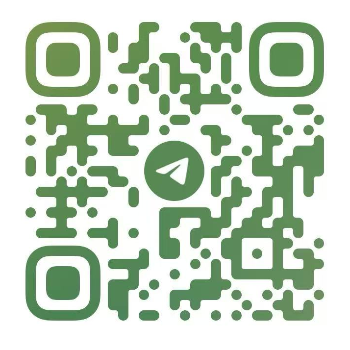
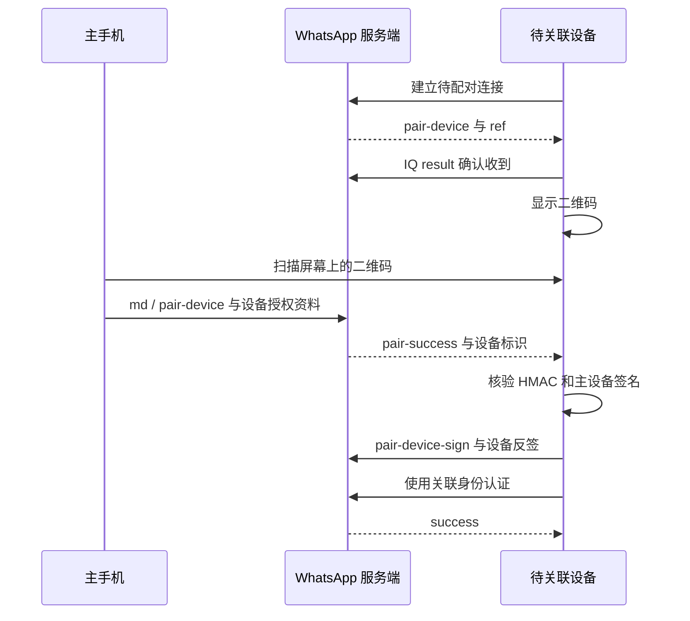
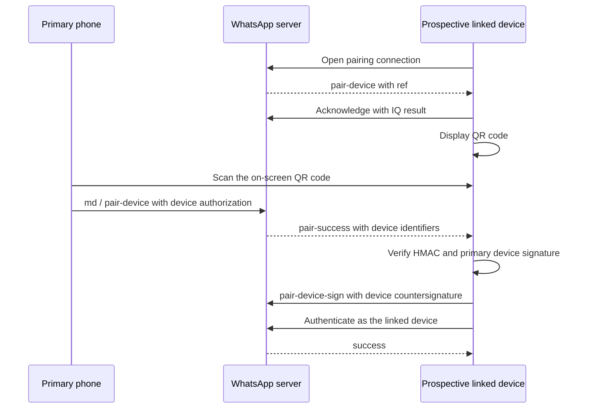

# WhatsApp 手机扫码登录与设备解绑 · WhatsApp QR Code Sign-In and Device Unlinking

[多设备目录](README.md#zh) · [首页](../README.md#zh) · [中文](#zh) · [English](#en)

[Telegram: @ttjjda](https://t.me/ttjjda)&nbsp;<a href="https://t.me/whatsap_lab"></a>

<a id="zh"></a>

## 中文

WhatsApp Web 和 Desktop 的扫码登录，会把浏览器或桌面客户端作为关联设备加入现有账号。已登录的主手机授权这次关联。新设备随后用自己的身份与凭据连接服务端，并同步近期消息和应用状态。 [WhatsApp 多设备架构](https://engineering.fb.com/2021/07/14/security/whatsapp-multi-device/)

### 阅读导航

[手机操作](#scan-zh) · [二维码字段](#qr-zh) · [设备身份确认](#pairing-zh) · [登录与同步](#sync-zh) · [失败与解绑](#unlink-zh)

<a id="scan-zh"></a>

### 1. 在主手机上扫码

1. 在要关联的电脑上打开 WhatsApp Web 或 WhatsApp Desktop，显示登录二维码。
2. 在已登录的主手机上打开 WhatsApp。Android 从右上角菜单进入「已关联的设备」，iPhone 从「设置」进入「已关联的设备」，再选择「关联设备」。
3. 按提示完成设备解锁或身份验证，用 WhatsApp 内的扫描界面对准电脑屏幕上的二维码。出现陌生设备确认时，核对要关联的设备，再选择是否继续。
4. 等待电脑进入聊天界面，在主手机的「已关联的设备」里核对刚加入的设备。近期消息可能还在同步。

关联从当前已登录的账号发起。首次用手机号验证并建立主设备身份的流程见[账号注册与验证](../registration/README.md#zh)。 [WhatsApp 关联设备操作指南](https://faq.whatsapp.com/1317564962315842/)、[已关联设备说明](https://faq.whatsapp.com/378279804439436/)

<a id="qr-zh"></a>

### 2. 二维码携带的配对材料

待关联设备准备独立的连接密钥和 Signal 身份密钥，再通过加密连接接收服务端为待配对会话分配的 `ref`。浏览器把它和自己的配对材料编码成二维码。Web 关联的一种负载形式如下，尖括号内是字段名。

```text
https://wa.me/settings/linked_devices#<ref>,<noise-public>,<identity-public>,<link-secret>,<platform>
```

| 字段 | 用途 |
| --- | --- |
| `ref` | 服务端用它找到当前待配对会话。二维码更新时，页面展示新的配对引用。 |
| `noise-public` | 待关联设备的 Noise 公钥，绑定配对和后续使用的连接身份。 |
| `identity-public` | 待关联设备的 Signal 身份公钥，主设备签署的关联资料会绑定这把公钥。 |
| `link-secret` | 本次关联的共享秘密，用于生成和核验配对资料的消息认证码。 |
| `platform` | 标记二维码所用的客户端平台格式。 |

Noise 和 Signal 的私钥由各设备自行持有。二维码中包含本次配对的共享秘密，应只扫描自己要关联的设备上显示的码。 [Noise 握手与加密传输](../protocol/noise.md#zh) · [多设备配对的安全分析](https://kclpure.kcl.ac.uk/ws/files/324396471/whatsapp.pdf#page=21)

<a id="pairing-zh"></a>

### 3. 扫码后如何确认设备身份



在普通端到端加密设备的关联流程中，服务端先通过 `pair-device` 下发引用，待关联设备用对应的 IQ 结果确认收到。主手机扫码后通过自己的已认证连接发送 `md` 命名空间下的 `pair-device`，包含配对引用、连接公钥、签名设备资料和签名设备索引列表。两个方向上的 `pair-device` 分别承担下发引用和提交授权。 [Protocol Tree Node](../protocol/protocol-tree-node.md#zh)

服务端用 `pair-success` 将配对资料和设备地址送到待关联设备。其中 `device` 节点的 `jid` 和 `lid` 分别给出 PN 和 LID 命名空间下的设备地址。设备先用二维码里的共享秘密核验 HMAC，再核验主设备对关联元数据和待关联设备 Signal 公钥的签名。验证通过后，待关联设备用自己的 Signal 身份私钥反签，作为 `pair-device-sign` 返回。这组签名把主设备与新设备各自的身份绑定到同一次关联。 [多设备配对的安全分析](https://kclpure.kcl.ac.uk/ws/files/324396471/whatsapp.pdf#page=7) · [设备地址](message-distribution.md#identities-zh)

<a id="sync-zh"></a>

### 4. 从配对确认到聊天可用

1. **认证连接。** 收到并校验 `pair-success` 后，待关联设备保存自己的关联资料。如果服务端要求重启配对连接，客户端用持久化的连接密钥和分配的设备身份重新认证，并检查 `success` 确认的是同一台设备。
2. **建立消息会话。** 新设备有独立的 Signal 身份和预密钥。服务端的设备目录更新后，发送端能为新设备建立独立会话并把它纳入后续消息分发。
3. **同步聊天数据。** 主手机将近期消息历史加密后发送给新设备。新设备用设备间端到端加密消息取得解密所需的材料，随后下载、解密并在本地保存。联系人名称、已归档聊天等应用状态也有独立的同步过程。同步范围取决于设备和数据类型。

连接认证成功和初始数据同步完成是两个状态。关联设备之后可以独立保持连接。 [历史消息同步说明](https://faq.whatsapp.com/653480766448040/) · [WhatsApp 多设备架构](https://engineering.fb.com/2021/07/14/security/whatsapp-multi-device/) · [逐设备消息分发](message-distribution.md#zh)

<a id="unlink-zh"></a>

### 5. 二维码过期、重连与解绑

| 情况 | 对应阶段和处理 |
| --- | --- |
| 二维码过期或已更新 | 当前页面需要展示有效的配对引用。回到待关联设备读取新码，再从手机的关联入口扫描。 |
| 手机确认页取消，或设备资料核验失败 | 本轮配对未通过。重新发起配对会准备新的待配对会话。 |
| 已扫码，电脑仍未进入聊天界面 | 配对确认、连接认证和初始同步按阶段推进。可在主手机检查设备是否已出现在「已关联的设备」列表，确认当前进行到了哪一步。 |
| 已关联设备网络中断 | 只要关联仍有效，客户端可以用本设备已保存的凭据重新认证。 |
| 设备被退出或解绑 | 可在主手机的「已关联的设备」中选择目标设备并退出，也可在关联设备上退出。设备目录更新后，目标设备会从后续分发中移除。要再次使用该设备时，需重新关联。 |

相关机制见[设备增删与会话更新](message-distribution.md#device-changes-zh)和[历史迁移与回执一致性](message-distribution.md#history-zh)。 [WhatsApp 解除关联操作指南](https://faq.whatsapp.com/834124628020911/)

<a id="en"></a>

## English

QR code sign-in on WhatsApp Web and Desktop adds the browser or desktop client to an existing account as a linked device. The signed-in primary phone authorizes the link. The new device then connects with its own identity and credentials, and synchronizes recent messages and application state. [WhatsApp multi-device architecture](https://engineering.fb.com/2021/07/14/security/whatsapp-multi-device/)

### Reading Guide

[Phone steps](#scan-en) · [QR code fields](#qr-en) · [Device identity confirmation](#pairing-en) · [Sign-in and synchronization](#sync-en) · [Failures and unlinking](#unlink-en)

<a id="scan-en"></a>

### 1. Scan with the Primary Phone

1. Open WhatsApp Web or WhatsApp Desktop on the computer you want to link and display the sign-in QR code.
2. Open WhatsApp on the signed-in primary phone. On Android, open **Linked devices** from the top-right menu. On iPhone, open **Linked Devices** from **Settings**. Select **Link a device**.
3. Unlock the phone or verify your identity if prompted. Point the scanner in WhatsApp at the QR code on the computer. If WhatsApp asks you to confirm an unrecognized device, check which device it is before deciding whether to continue.
4. Wait for the chat interface to open on the computer, then check **Linked devices** on the primary phone for the new entry. Recent messages may still be synchronizing.

Linking starts from an account that is already signed in. See [Account Registration and Verification](../registration/README.md#en) for verifying a phone number and establishing the primary device identity. [WhatsApp device-linking guide](https://faq.whatsapp.com/1317564962315842/), [About linked devices](https://faq.whatsapp.com/378279804439436/)

<a id="qr-en"></a>

### 2. Pairing Material in the QR Code

The device preparing to link generates its own connection and Signal identity keys. Over an encrypted connection, it receives a `ref` assigned by the server to the pending pairing session. The browser encodes that reference together with its pairing material. One Web payload format is shown below with field names in angle brackets.

```text
https://wa.me/settings/linked_devices#<ref>,<noise-public>,<identity-public>,<link-secret>,<platform>
```

| Field | Purpose |
| --- | --- |
| `ref` | Lets the server identify the pending pairing session. When the QR code refreshes, the page shows a new pairing reference. |
| `noise-public` | The prospective linked device's Noise public key. It binds the pairing to the connection identity used afterward. |
| `identity-public` | The prospective linked device's Signal identity public key. The primary device binds this key into the signed linking material. |
| `link-secret` | The shared secret for this link. It keys the message authentication code used to verify the pairing material. |
| `platform` | Identifies the client platform format of the QR code. |

Each device keeps its own Noise and Signal private keys. The QR code contains the shared secret for this pairing, so scan the code displayed on the device you intend to link. [Noise Handshakes and Encrypted Transport](../protocol/noise.md#en) · [Security analysis of multi-device linking](https://kclpure.kcl.ac.uk/ws/files/324396471/whatsapp.pdf#page=21)

<a id="pairing-en"></a>

### 3. Device Identity Confirmation After Scanning



When linking an ordinary end-to-end encrypted device, the server first sends the reference in `pair-device`. The prospective linked device acknowledges receipt with the matching IQ result. After scanning, the primary phone sends `pair-device` in the `md` namespace over its own authenticated connection, with the pairing reference, connection public key, signed device identity material, and signed device index list. The two directions of `pair-device` deliver a reference and submit authorization, respectively. [Protocol Tree Node](../protocol/protocol-tree-node.md#en)

The server sends the pairing material and device addresses to the prospective linked device in `pair-success`. The `jid` and `lid` attributes of the `device` node give the device addresses in the PN and LID namespaces. The device verifies the HMAC with the QR code's shared secret, then verifies the primary device's signature over the linking metadata and the prospective device's Signal public key. After verification, it countersigns with its own Signal identity private key and returns `pair-device-sign`. The signatures bind both device identities to the same link. [Security analysis of multi-device linking](https://kclpure.kcl.ac.uk/ws/files/324396471/whatsapp.pdf#page=7) · [Device addressing](message-distribution.md#identities-en)

<a id="sync-en"></a>

### 4. From Pairing Confirmation to Available Chats

1. **Authenticate the connection.** After receiving and verifying `pair-success`, the prospective linked device saves its linking material. If the server requests a restart of the pairing connection, the client reauthenticates with its persisted connection key and assigned device identity. It checks that `success` confirms that same device.
2. **Establish message sessions.** The new device has its own Signal identity and prekeys. Once the server's device directory is updated, senders can establish a separate session for the new device and include it in subsequent message distribution.
3. **Synchronize chat data.** The primary phone encrypts recent message history for the new device. The new device receives the decryption material in an end-to-end encrypted message between devices, then downloads, decrypts, and stores the history locally. Application state, such as contact names and archived chats, has its own synchronization process. The scope depends on the device and data type.

Successful connection authentication and completion of the initial sync are separate states. The linked device can subsequently maintain an independent connection. [About message history on linked devices](https://faq.whatsapp.com/653480766448040/) · [WhatsApp multi-device architecture](https://engineering.fb.com/2021/07/14/security/whatsapp-multi-device/) · [Per-device message distribution](message-distribution.md#en)

<a id="unlink-en"></a>

### 5. QR Code Expiration, Reconnection, and Unlinking

| Situation | Stage and handling |
| --- | --- |
| The QR code expired or refreshed | The current page needs to display a valid pairing reference. Get the new code from the device you want to link and scan it from the phone's linking screen. |
| Confirmation was cancelled on the phone, or identity verification failed | The pairing attempt did not complete. Starting a new attempt prepares a new pending pairing session. |
| The QR code was scanned, and chats have yet to open on the computer | Pairing confirmation, connection authentication, and the initial sync proceed in stages. Check **Linked devices** on the primary phone to see whether the device has been added. |
| A linked device lost network connectivity | While the link is valid, the client can reauthenticate with the credentials saved for that device. |
| The device was logged out or unlinked | Select the target device under **Linked devices** on the primary phone and log it out, or log out on the linked device itself. After the device directory updates, subsequent distribution excludes that device. To use it again, link it again. |

See [Device Changes and Session Updates](message-distribution.md#device-changes-en) and [History Transfer and Receipt Consistency](message-distribution.md#history-en) for the related mechanisms. [WhatsApp device-unlinking guide](https://faq.whatsapp.com/834124628020911/)
