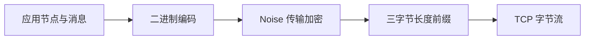
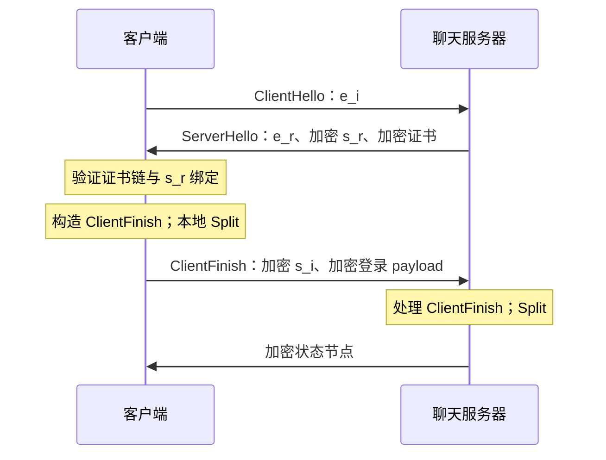
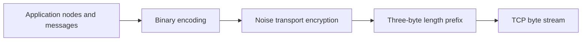

# Noise Protocol · Noise 握手与加密传输

[首页](../README.md#zh) · [协议目录](README.md#zh) · [中文](#zh) · [English](#en) · [Telegram: @ttjjda](https://t.me/ttjjda)

<a id="zh"></a>

## 中文

Noise 为客户端与聊天服务器建立经过身份认证的加密通道：握手阶段交换公钥、组合共享秘密、认证服务器并提交登录信息；传输阶段使用两个方向独立的密钥和计数器保护数据帧。

本文介绍移动端 `WA 06 03` 连接的经典 XX、IK、XXfallback，以及结合 X25519 与 ML-KEM-512 的 IKKEM_FS 和对应 fallback。协议名、握手状态、Protobuf、证书和登录 payload 共同决定互通行为。

[协议层次](#zh-layers) · [密钥与状态](#zh-state) · [XX](#zh-xx) · [IK 与 fallback](#zh-fallback) · [封装](#zh-wire) · [服务器认证](#zh-certificates) · [后量子握手](#zh-pq) · [登录与响应](#zh-login) · [错误处理](#zh-errors)

<a id="zh-layers"></a>

### 1. 协议层次与职责



握手期间，长度前缀后的内容是包含 `ClientHello`、`ServerHello` 或 `ClientFinish` 的 Protobuf；完成握手后，则是 Noise 传输密文。解密后的应用数据仍需按二进制节点格式解析，不能直接当成 JSON、XML 或 UTF-8 文本。

| 层次 | 职责 |
| --- | --- |
| TCP 与路由前缀 | 连接、流式读写及可选路由信息 |
| Noise | 客户端与聊天服务器之间的身份认证、密钥协商和传输保护 |
| 登录 payload 与状态节点 | 账号身份、客户端能力、连接信息及登录结果 |
| Signal 消息层 | 发送设备与接收设备之间的消息端到端加密；其密文可继续装入 Noise 通道 |
| 注册 HTTP 封装 | [ENC、H 与 Authorization](../registration/request-encryption.md#zh)保护注册请求，各有自己的密钥、签名和编码规则 |

`g.whatsapp.net:443` 的这种连接可直接在 TCP 上发送移动端头和 Noise 帧；端口 443 本身不表示外面还有 TLS。Noise 连接静态密钥、Signal 身份密钥和 HTTP 签名密钥承担不同职责，不能互换。

Noise 的通用框架由握手模式和密码学算法组合定义；应用还需定义封装、身份信任和 payload 语义。[Noise Protocol Framework](https://noiseprotocol.org/noise.html)

<a id="zh-state"></a>

### 2. 密钥、算法与状态推进

经典协议名为：

```text
Noise_XX_25519_AESGCM_SHA256
Noise_IK_25519_AESGCM_SHA256
Noise_XXfallback_25519_AESGCM_SHA256
```

名称参与握手哈希初始化，大小写、分隔符和完整字节都必须保留。这里的 `25519` 对应 X25519，`AESGCM` 使用 32 字节密钥，`SHA256` 用于哈希及 HMAC/HKDF。

| 符号 | 含义 |
| --- | --- |
| `s_i / s_r` | 客户端/服务器的长期连接静态密钥对 |
| `e_i / e_r` | 本次握手的客户端/服务器临时密钥对 |
| `rs / re` | 对端静态公钥/临时公钥 |
| `h` | 握手 transcript 的哈希，参与握手密文的 AAD |
| `ck` | chaining key，累积 DH/KEM 共享秘密并供 Split 派生传输密钥 |
| `k / n` | 当前阶段的对称密钥和消息计数器 |

下文将密钥符号用于消息字段时表示其公钥字节。X25519 原始公钥为 32 字节；带 16 字节 GCM tag 的加密静态公钥为 48 字节。这里发送原始二进制，不对公钥或密文统一做 Base64。

#### 初始化与派生

```text
initial = protocol_name 右侧补零到 32 字节   # 名称长度 ≤ 32
        或 SHA256(protocol_name)          # 名称长度 > 32
ck = initial
h  = SHA256(initial || prologue)
k  = empty
n  = 0
```

IK 随后还把已知的服务器静态公钥混入 `h`。Prologue 更新 `h`，不会直接重设 `ck`。以下运算中的 `||` 表示字节拼接：

```text
MixHash(data):
    h = SHA256(h || data)

HKDF2(ck, ikm):
    prk = HMAC-SHA256(key=ck, data=ikm)
    t1  = HMAC-SHA256(key=prk, data=0x01)
    t2  = HMAC-SHA256(key=prk, data=t1 || 0x02)
    return t1, t2

MixKey(ikm):
    ck, k = HKDF2(ck, ikm)
    n = 0
```

握手加密使用当前 `h` 作 AAD，生成密文后再 `MixHash(ciphertext)`；解密认证成功后也混入同一密文字节。静态公钥以加密字段出现时，混入的是包含 tag 的密文；IK 初始化时作为 pre-message 混入的则是可信缓存公钥明文。经典 XX/IK 中，加密静态公钥与加密 payload 是两个操作，不能将其拼成一个 GCM 调用来省略一次 tag 或状态推进。

#### nonce 与 Split

AES-GCM nonce 为 12 字节：

```text
nonce = 00 00 00 00 || uint64_be(n)
```

每次 `MixKey` 重置握手计数器。解密尝试先取出并递增 `n`，再执行认证；因此认证失败也消耗该计数值。失败后应结束当前握手或通道，不能回退计数器继续尝试。

握手结束时执行 `HKDF2(ck, empty)`：第一份 32 字节密钥用于客户端→服务器，第二份用于服务器→客户端。两个方向各自从 `n=0` 开始；传输帧的 AAD 为空，不再把每条传输密文混入握手 `h`。相同密钥下的 nonce 不能复用；`2⁶⁴−1` 是保留值，普通消息计数达到它时必须停止使用该 cipher state。

<a id="zh-xx"></a>

### 3. XX：通过本次握手认证服务器

XX 不要求事先持有服务器静态公钥。客户端先公开自己的临时公钥，随后从服务器响应中取得并认证服务器静态公钥，最后提交自己的静态公钥与登录 payload。



| 消息 | token 顺序 | 字段与状态 |
| --- | --- | --- |
| ClientHello | `e` | 混入并发送 `e_i`；此时无对称密钥 |
| ServerHello | `e, ee, s, es` | 混入 `e_r`；`ee` 派生密钥；解密 `s_r` 并混入其密文；`es` 再派生密钥；解密证书 payload 并混入其密文 |
| ClientFinish | `s, se` | 加密 `s_i` 并混入其密文；`se` 再派生密钥；加密登录 payload 并混入其密文；本地 Split |

`ee = DH(e_i, e_r)`，`es = DH(e_i, s_r)`，`se = DH(s_i, e_r)`。客户端和服务器从各自私钥与对方公钥得到相同共享秘密。

客户端在构造完最后一条握手消息时即可执行本地 Split，随后才由发送层加长度前缀并写入 socket。构造成功、发送成功和服务器收到并接受是三个不同的状态；本地已有传输密钥不能代替网络写入结果。

#### 首包空 payload 的哈希规则

经典 XX 的第一条消息只处理客户端临时公钥，没有额外的空 payload 哈希步骤。设混入 `e_i` 后的值为 `h_e`：

```text
h_e = SHA256(h_before_e || e_i)
本连接的首包结束状态：h = h_e
若再执行 MixHash(empty)：h = SHA256(h_e)
```

这两个状态不同，而第一包公钥字节可以相同。由于第二包 GCM 认证使用 `h` 作为 AAD，多出一次哈希会导致后续认证失败。通用握手状态机若在无密钥、空 payload 时仍执行哈希，需要显式处理这个差异。

这个规则仅涉及无密钥的空 payload。已有密钥时，空明文仍产生 16 字节认证 tag，并正常混入密文；不能把所有空 payload 都跳过。

<a id="zh-fallback"></a>

### 4. IK 恢复与同连接 fallback

#### IK：使用可信的缓存服务器公钥

IK 将已知 `s_r` 作为 pre-message 输入。它仍使用新的临时密钥和新的共享秘密，不直接复用旧连接的传输密钥。

```text
预先已知：s_r
客户端 → 服务器：e, es, s, ss，客户端 payload
服务器 → 客户端：e, ee, se，服务器 payload
```

客户端在首包依次混入 `e_i`、执行 `es`、加密自己的静态公钥、执行 `ss = DH(s_i, s_r)`，最后加密登录 payload。服务器正常响应含 `e_r` 和加密 payload；完成 `ee`、`se` 与响应认证后即可 Split，不再发送 ClientFinish。

正常 IK 通过可信缓存静态公钥和成功的 AEAD 认证确认服务器身份，不要求每次重新传递 XX 证书链。缓存公钥的信任来源和生命周期属于认证条件，不能仅因它是 32 字节就视为可信。

#### XXfallback：接续已经发出的 IK 首包

当 IK 的服务器响应带有加密静态公钥字段时，客户端可进入 XXfallback。缓存密钥失配是触发场景之一；服务器也可能直接关闭连接，客户端不能保证得到 fallback 响应。

切换顺序为：

1. 保留同一 TCP 连接和已经发送的 `e_i` 密钥对。
2. 丢弃 IK 的 `h/ck/k/n`，以完整的 XXfallback 协议名和相同 prologue 初始化新 transcript。
3. 将原 `e_i` 公钥混入新 `h`，在本地接续状态，不再次发送 ClientHello。
4. 处理服务器的 `e_r, ee, s_r, es` 和证书 payload，校验服务器身份。
5. 发送包含客户端静态公钥和登录 payload 的 ClientFinish，再进入传输阶段。

不能将 fallback 当作“重新发一次普通 XX”：换临时密钥、沿用 IK 的旧 chaining key、重复发送首包或混用协议名都会改变 transcript。网络超时、证书错误、GCM tag 错误也不能统一解释成 fallback 指令。

<a id="zh-wire"></a>

### 5. 移动端头、Protobuf 与帧结构

#### 连接前缀与长度

```text
有路由信息时：
45 44 00 01 || uint24_be(routing_length) || routing_info

随后：
57 41 06 03 || uint24_be(handshake_length) || HandshakeMessage

后续每帧：
uint24_be(frame_length) || frame_bytes
```

`57 41` 是 ASCII `WA`；`57 41 06 03` 同时作为本连接的 prologue。`06` 是移动端连接头的一部分，不能解释为 Noise 规范修订号。可选路由前缀以 `ED 00 01` 开始，先于 WA 头写入，不拼入这里的 Noise prologue。连接前缀不会在每条传输帧前重复。

三字节长度表示紧随其后的帧内容字节数，不含长度前缀自身。其表示范围与具体消息解析器、Noise 消息及本地缓冲上限分开处理。TCP 读取可能拆分一个帧或合并多个帧，接收端必须先读满三字节，再按长度读满内容。

#### 握手字段

以下 length-delimited 字段中的公钥、密文、子消息均为二进制；Protobuf 字段标签和长度不替代内部密码学状态推进。

| 外层 HandshakeMessage 字段 | 子消息 |
| --- | --- |
| `2` | ClientHello |
| `3` | ServerHello |
| `4` | ClientFinish |

| 子消息 | 字段号 | 内容 |
| --- | --- | --- |
| ClientHello | `1` | 客户端临时公钥，32 字节 |
| ClientHello，经典 IK | `2` | 加密客户端静态公钥，48 字节 |
| ClientHello | `3` | 加密客户端 payload；IKKEM_FS 将静态公钥与 payload 合并加密在此 |
| ServerHello | `1` | 服务器临时公钥，32 字节 |
| ServerHello，XX/fallback | `2` | 加密服务器静态公钥，48 字节；也是恢复响应与 fallback 响应的区分字段 |
| ServerHello | `3` | 加密服务器 payload；XX 中包含证书，PQ fallback 还包含 KEM 元数据 |
| ClientFinish | `1` | 加密客户端静态公钥 |
| ClientFinish | `2` | 加密客户端登录 payload |
| PQ 扩展 | 见后文 | KEM 密文、新公钥与分支信息 |

例如，经典 XX 首包可表示为：

```text
57 41 06 03       # WA 头 / prologue
00 00 24          # HandshakeMessage 长度 36
12 22             # 外层字段 2，子消息长度 34
0a 20 <e_i:32B>   # ClientHello 字段 1，32 字节公钥
```

此处没有账号标识或客户端静态公钥。握手操作使用各阶段定义的原始公钥和密文字节；不能把整个 Protobuf 或长度前缀直接送入 `MixHash` 代替这些输入。

<a id="zh-certificates"></a>

### 6. 服务器证书与静态公钥绑定

XX 和 fallback 在解密服务器静态公钥及证书 payload 后，沿固定信任根验证服务器身份。这里使用 Protobuf 证书结构，证书签名格式也需要对应的曲线转换，不能当作 HTTP 的 DER/X.509 链处理。

| 检查 | 要求 |
| --- | --- |
| 中间证书的 issuer | 指向根，值为 `0` |
| 叶证书 issuer 与中间证书 serial | 必须相等 |
| 中间公钥与叶公钥 | 均为 32 字节 |
| 中间证书签名 | 用固定根公钥验证中间 details 原始字节 |
| 叶证书签名 | 用中间公钥验证解析后重新序列化的叶 details |
| 叶公钥绑定 | 必须逐字节等于本次 Noise 解密得到的服务器静态公钥 |

叶 details 的重序列化按字段处理已知值并保留未知字段；中间 details 则直接使用原字节。随意按 JSON 重建、排序所有字段或丢弃未知字段可能改变签名输入。

签名验证将 Montgomery 公钥坐标 `u` 转为 Edwards 坐标 `y=(u−1)/(u+1) mod (2²⁵⁵−19)`，从签名最后一个字节的最高位取得公钥符号位，并在验证前清除签名中的该位。公钥和签名字节的格式、长度及非法坐标都需要检查。

此处 `WA 06 03` 证书分支不以 details 中的有效期时间字段作为拒绝条件；签名、issuer/serial 和静态公钥绑定仍必须通过。其他认证分支的时间策略需按对应条件处理。

成功解密证书只说明握手密文通过认证；证书签名和公钥绑定检查还需单独完成。正常 IK/IKKEM_FS 恢复则依赖可信缓存密钥与响应认证，不能将“本次没有新证书链”误记为“重新校验了证书”。

<a id="zh-pq"></a>

### 7. X25519 与 ML-KEM-512 混合握手

ML-KEM 是用于建立共享秘密的密钥封装机制；ML-KEM-512 是其参数集之一。[NIST FIPS 203](https://csrc.nist.gov/pubs/fips/203/final)

这里展开 IKKEM_FS 与它的 XXkem-FSfallback。分支必须匹配完整协议名、KEM 位置、哈希输入和编码；仅把经典 IK 的算法名字改成 PQ 名字不会执行这些操作。

```text
恢复：Noise_IKkem-FS+X25519+MLKEM512+AESGCM256+SHA256
回退：Noise_XXkem-FSfallback_25519_MLKEM512_AESGCM_SHA256
```

| ML-KEM-512 材料 | 字节数 |
| --- | ---: |
| 公钥 | 800 |
| 私钥 | 1632 |
| 封装密文 | 768 |
| 共享秘密 | 32 |

KEM 操作将密文混入 `h`，将共享秘密传给 `MixKey`，不把 KEM 密文自身当 AES 密钥。TLV 使用 `type:1 || length:2，大端 || value`；传输中的 TLV 外壳与实际混入哈希的材料需要区分。

ML-KEM 的隐式拒绝机制可能对被改动的密文返回一个不同的 32 字节秘密，而不直接抛出异常。解封装返回了正确长度，不足以宣布成功；必须继续检查后续握手 AEAD 认证。经典 XX/IK 不包含 ML-KEM 保护，PQ fallback 则仍将新的 KEM 秘密混入密钥派生。

#### IKKEM_FS 正常恢复

初始化后先将缓存服务器 X25519 公钥混入 `h`；另外准备服务器 ML-KEM 公钥。客户端首包按以下顺序处理：

1. 生成新的 X25519 临时密钥并 `MixHash(e_i)`。
2. 对缓存服务器 ML-KEM 公钥封装，得到 `ct_static/ss_static`；依次 `MixHash(ct_static)`、`MixKey(ss_static)`。
3. 生成本次客户端 ML-KEM 密钥对，将 `11 00 || client_fs_public` 共 802 字节混入 `h`。
4. 执行 `es`，把 `s_i.public || ClientPayload` 合在一次 `EncryptAndHash` 中加密，再执行 `ss`。

首包扩展字段为：

| ClientHello 字段 | wire 内容 |
| --- | --- |
| `1` | `e_i` |
| `3` | `EncryptAndHash(s_i.public \|\| ClientPayload)` |
| `5` | TLV type `1`，值为 768 字节 `ct_static` |
| `9` | varint 分支值 `6` |
| `10` | TLV type `3`，值为 `11 00 \|\| client_fs_public`；内层两字节密钥类型标识独立于外层 TLV type |

服务器正常恢复响应不带字段 `2`；客户端混入 `e_r`，从 ServerHello 字段 `6` 的 type `4` TLV 读取 768 字节密文，用本次客户端 KEM 私钥解封装，然后依次执行：

```text
MixHash(ct_fs) → MixKey(ss_fs) → ee → se
→ DecryptAndHash(server_payload) → Split
```

这一分支没有 ClientFinish。服务器响应能通过认证，才可确认缓存密钥和新鲜 KEM 交换对应的握手成立。

#### PQ fallback

恢复响应若带加密静态公钥字段 `2`，则以 fallback 协议名初始化新状态，并复用最初的 `e_i`：

```text
MixHash(e_i) → MixHash(e_r) → ee
→ 解密 s_r → es → 解密组合 payload
```

组合 payload 为 type `1` 的 `MLKEM512` 算法名、type `2` 的 800 字节新服务器 KEM 公钥，再接证书字节。客户端对该公钥封装，将 768 字节密文混入 `h`、共享秘密混入 `ck/k`，并完成证书链及 `s_r` 绑定检查。

随后加密客户端静态公钥，执行 `se`，加密登录 payload。ClientFinish 的字段 `1/2/3` 分别携带加密静态公钥、加密登录 payload 和原始 768 字节 KEM 密文；构造完后执行本地 Split，再由发送层写出。

Protobuf 字段顺序不等于密码学运算顺序：ClientFinish 中 KEM 密文虽然编号为 `3`，它仍须先于字段 `1/2` 的加密操作进入 `MixHash/MixKey`。

协议还区分其他 KEM 模式与变体；这里的字段表和操作顺序专用于上述两个完整协议名。模式选择需要同时考虑策略和可用的可信密钥材料，未知变体或格式错误不能静默改走经典 XX。

<a id="zh-login"></a>

### 8. ClientPayload、传输解密与登录结果

客户端静态密钥证明连接身份，ClientPayload 则声明账号、设备与本次连接。二者必须对应可用的账号状态。全新的本地静态密钥与空 payload 可以用于握手阶段的交互，但不自动取得账号登录资格。

ClientPayload 是 proto2 消息。字段缺失、显式 `false`、`0` 和空字符串具有不同 presence 语义，不能统一删掉。以下为主设备 LID 登录的一组字段职责：

| 字段 | 内容与条件 |
| --- | --- |
| `username`、`product` | 数值账号身份及身份类别；LID 分支使用已保存的 `self_lid`，product 为 `WHATSAPP_LID=4` |
| `user_agent` | 平台、应用版本、系统、厂商/型号、语言/国家、PhoneId、设备实验 ID 等子字段 |
| `push_name` | 非空昵称才设置 |
| `passive`、`short_connect` | 本次连接行为与推送/登录状态共同决定的连接方式 |
| `session_id` | 本次连接的 32 位会话标识，按 `sfixed32` 小端编码 |
| `connect_type`、`connect_reason`、`dns_source` | 网络类别、连接触发原因及实际解析路径 |
| `connect_attempt_count`、`lc` | 本次尝试与持久登录计数，各按其生命周期取值 |
| `oc` | 安装身份、签名与版本条件的检查结果 |
| `year_class`、`mem_class` | 设备性能分类与内存等级 |
| `traffic_anonymization`、`lid_db_migrated`、`paa_link` | 所选网络、数据库迁移及关联状态 |
| `connection_sequence_info` | 端口、路径、生命周期、socket 尝试和 VPN 位组成的 `sfixed32` |

普通整数、布尔和枚举使用 varint；字符串和子消息使用 length-delimited。客户端 payload 在 XX/fallback 的 ClientFinish 中加密，在 IK 的首包中加密；IKKEM_FS 首包还将连接静态公钥与其合并加密。密钥记录的本地存储加密属于另一层。

使用已保存的合法连接密钥和完整来源状态，可以生成新的 payload；会话 ID、解析路径和连接尝试信息应反映本次连接。XX 的前两条消息不依赖缓存服务器公钥；这也不意味着账号 payload 或客户端连接私钥可以省略。

#### 保存状态与身份分支

主设备 LID 分支要求选择该身份类别，并从 `com.whatsapp_preferences_light` 的 `self_lid` 读取身份；`registration_lid` 是另一份注册状态，不作为缺失时的自动替代。普通 Wi-Fi 主设备的配置组包还需已完成注册/偏好迁移、已初始化的 PhoneId/PerfId/性能分类，以及系统网络、Locale 和数据库迁移状态。伴生、Phone-JID、PAA 或代理/匿名化分支需要各自的来源和状态处理，不能用这份 LID payload 固定值替代。

连接密钥可保存在 `keystore.xml` 的 `client_static_keypair_pwd_enc`。PWD2/type `2` 记录经口令派生和 AES-OFB 解密后应得到 `private32 || public32` 共 64 字节，并用私钥重新派生公钥核对。type `0` 记录依赖实际 AndroidKeyStore，单独复制 XML 不足以在电脑端解密。记录解密和密钥对自洽检查不能单独证明账号仍有效，也不能证明另一运行进程当前选择了这份记录。

#### 传输与应用结果分层

| 所处阶段 | 能够确认的行为 |
| --- | --- |
| 收到完整 ServerHello | 得到一个可解析的握手响应 |
| 完成服务器身份认证 | XX/fallback 的证书链及静态键绑定通过，或恢复分支的可信缓存密钥认证通过 |
| 本地 Split、发出所需 ClientFinish | 客户端完成本地握手计算与写入 |
| 认证解密服务器 transport 帧 | 服务器返回的传输数据可用派生的读密钥认证 |
| 完整解析得到 `success` | 服务器接受本次账号登录；还需核对返回身份与所请求账号对应 |
| 得到 `failure` 或 `stream:error` | 通道可以已经成立，服务器报告登录失败或流级错误；具体原因需读取节点及属性 |

传输明文先读标志字节；`0x02` 位表示其后内容需按 zlib 解压，再解析二进制列表、token 字典和压缩 JID。完整解析还要检查子节点、属性及尾部剩余字节，仅读到根标签不能保证整包有效。可读 XML 是解析展示形式；例如以下为合成展示，既不是 wire 格式，也不定义响应固定属性集合：

```xml
<success lid="123456789012345@lid" location="example" />
```

认证的 `success` 还可返回 `static_pq_key` 属性。对于这里的 ML-KEM-512 分支，其文本经标准 Base64 解码后为 800 字节服务器公钥，可供上层管理后续恢复所需的缓存。收到此字段与完成本地持久化是不同动作，不能据此假设下一条连接已自动使用新缓存。

ClientFinish 后 EOF、半帧 EOF 或超时，只能说明连接在相应阶段结束；不能仅凭它认定 payload 错误或账号登录成功。`success` 也不等于已完成后续心跳、消息收发、历史同步或长期会话维护。

<a id="zh-errors"></a>

### 9. 状态生命周期与错误处理

| 条件 | 处理 |
| --- | --- |
| 缺少可信服务器缓存 | 选择允许的完整握手；不要伪造缓存已认证状态 |
| 明确的 fallback 响应 | 同连接切换协议名和 transcript，保留原客户端临时密钥 |
| 证书签名、issuer 或静态公钥绑定错误 | 终止握手 |
| GCM 认证失败 | 停止使用当前状态；不回退 nonce、不继续发送 payload |
| 不支持的 KEM 算法、TLV 类型或长度 | 拒绝该分支，不以降级替代解析 |
| 本地 Split 后发送失败或未收到认证帧 | 保留失败阶段，不宣布服务器接受握手 |
| 传输帧已认证但节点解析失败 | 区分密码学成功与应用解析失败，不猜测 `success` |
| 新建连接 | 生成新临时密钥和本次连接状态，不复用旧 transport key/counter |

实现通道时，应把算法状态、封装读写、服务器信任、账号 payload 和应用节点处理分别连接起来。任一层输入不匹配，都可能表现为断连或认证失败；仅对齐公钥长度或第一包字节不足以保证后续互通。

修改后的开源实现：[WhatsappWiki/noiseprotocol-whatsapp](https://github.com/WhatsappWiki/noiseprotocol-whatsapp.git)。

### 相关主题

[通信协议与数据格式](README.md#zh) · [登录认证与会话](../authentication/README.md#zh) · [端到端加密与密钥管理](../encryption/README.md#zh) · [消息发送与接收](../messaging/README.md#zh) · [注册请求加密](../registration/request-encryption.md#zh)

<a id="en"></a>

## English

Noise establishes an authenticated encrypted channel between a client and the chat server. The handshake exchanges public keys, combines shared secrets, authenticates the server, and submits login information. Transport then protects frames with independent keys and counters for each direction.

This article covers classical XX, IK, and XXfallback for the mobile `WA 06 03` connection, plus IKKEM_FS and its fallback combining X25519 and ML-KEM-512. Interoperability depends on the protocol name, handshake state, Protobuf envelope, certificates, and login payload together.

[Layers](#en-layers) · [Keys and state](#en-state) · [XX](#en-xx) · [IK and fallback](#en-fallback) · [Framing](#en-wire) · [Server authentication](#en-certificates) · [Post-quantum handshake](#en-pq) · [Login and responses](#en-login) · [Errors](#en-errors)

<a id="en-layers"></a>

### 1. Protocol Layers and Responsibilities



During the handshake, the length-prefixed content is a Protobuf containing ClientHello, ServerHello, or ClientFinish. Afterward, it is Noise transport ciphertext. Decrypted application data still requires binary-node parsing; it is not automatically JSON, XML, or UTF-8 text.

| Layer | Responsibility |
| --- | --- |
| TCP and routing prefix | Connection, stream I/O, and optional routing information |
| Noise | Client-to-chat-server authentication, key agreement, and transport protection |
| Login payload and status nodes | Account identity, client capabilities, connection information, and login outcome |
| Signal message layer | Device-to-device end-to-end message encryption; its ciphertext can travel inside Noise |
| Registration HTTP envelope | [ENC, H, and Authorization](../registration/request-encryption.md#en) protect registration requests with their own keys, signatures, and encodings |

This connection to `g.whatsapp.net:443` can carry the mobile header and Noise frames directly over TCP. Port 443 alone does not imply an outer TLS layer. Noise connection static keys, Signal identity keys, and HTTP signing keys have separate roles.

The general Noise framework combines handshake patterns with cryptographic algorithms; applications additionally define framing, identity trust, and payload semantics. [Noise Protocol Framework](https://noiseprotocol.org/noise.html)

<a id="en-state"></a>

### 2. Keys, Algorithms, and State Transitions

The classical names are:

```text
Noise_XX_25519_AESGCM_SHA256
Noise_IK_25519_AESGCM_SHA256
Noise_XXfallback_25519_AESGCM_SHA256
```

The full name initializes the handshake hash, so case, separators, and every byte matter. Here, `25519` selects X25519, AESGCM uses a 32-byte key, and SHA256 supplies hashing and HMAC/HKDF.

| Symbol | Meaning |
| --- | --- |
| `s_i / s_r` | Client/server long-term connection static key pairs |
| `e_i / e_r` | Fresh client/server ephemeral key pairs |
| `rs / re` | Remote static/ephemeral public keys |
| `h` | Handshake transcript hash, used as handshake AEAD associated data |
| `ck` | Chaining key accumulating DH/KEM secrets and feeding Split |
| `k / n` | Current symmetric key and message counter |

When a key symbol denotes a message field below, it means public-key bytes. Raw X25519 public keys are 32 bytes; an encrypted static public key with a 16-byte GCM tag is 48 bytes. These fields carry binary data without a universal Base64 layer.

#### Initialization and Derivation

```text
initial = protocol_name padded on the right with zeros to 32 bytes  # length ≤ 32
        or SHA256(protocol_name)                                 # length > 32
ck = initial
h  = SHA256(initial || prologue)
k  = empty
n  = 0
```

IK additionally hashes the known server static public key into `h`. The prologue updates `h` without directly resetting `ck`. Here `||` denotes byte concatenation:

```text
MixHash(data):
    h = SHA256(h || data)

HKDF2(ck, ikm):
    prk = HMAC-SHA256(key=ck, data=ikm)
    t1  = HMAC-SHA256(key=prk, data=0x01)
    t2  = HMAC-SHA256(key=prk, data=t1 || 0x02)
    return t1, t2

MixKey(ikm):
    ck, k = HKDF2(ck, ikm)
    n = 0
```

Handshake encryption uses the current `h` as AAD, then hashes the ciphertext. Successful decryption hashes the same ciphertext. An encrypted static-key field contributes its ciphertext including the tag; the trusted cached public key used as an IK pre-message contributes plaintext public-key bytes instead. In classical XX/IK, encrypting a static public key and encrypting a payload are separate operations; combining them into one GCM call changes tags and state transitions.

#### Nonces and Split

The 12-byte AES-GCM nonce is:

```text
nonce = 00 00 00 00 || uint64_be(n)
```

Each MixKey resets the handshake counter. A decryption attempt takes and increments `n` before authentication, so a failed authentication also consumes that value. End the handshake or channel after failure instead of rolling back the counter.

At handshake completion, `HKDF2(ck, empty)` produces client-to-server and server-to-client 32-byte keys, in that order. Each direction starts its own counter at zero. Transport uses empty AAD and does not keep hashing transport ciphertext into the handshake `h`. Never reuse a nonce with the same key. The value `2⁶⁴−1` is reserved; stop using the cipher state when its ordinary-message counter reaches it.

<a id="en-xx"></a>

### 3. XX: Authenticating the Server During the Handshake

XX does not require a cached server static public key. The client first sends its ephemeral key, obtains and authenticates the server static key, and then submits its own static public key and login payload.

```mermaid
sequenceDiagram
  participant C as Client
  participant S as Chat server
  C->>S: ClientHello: e_i
  S->>C: ServerHello: e_r, encrypted s_r, encrypted certificate
  Note over C: Verify chain and s_r binding
  Note over C: Construct ClientFinish; local Split
  C->>S: ClientFinish: encrypted s_i and login payload
  Note over S: Process ClientFinish; Split
  S->>C: Encrypted status node
```

| Message | Token order | Fields and state |
| --- | --- | --- |
| ClientHello | `e` | Hash and send `e_i`; no symmetric key yet |
| ServerHello | `e, ee, s, es` | Hash `e_r`; derive with ee; decrypt `s_r` and hash its ciphertext; derive with es; decrypt the certificate payload and hash its ciphertext |
| ClientFinish | `s, se` | Encrypt `s_i` and hash its ciphertext; derive with se; encrypt login payload and hash its ciphertext; local Split |

Here `ee = DH(e_i, e_r)`, `es = DH(e_i, s_r)`, and `se = DH(s_i, e_r)`. Each peer obtains the same shared secret using its private key and the other peer's public key.

The client can perform local Split while constructing its final handshake message. The sending layer then adds the length prefix and writes it to the socket. Successful construction, successful writing, and remote receipt and acceptance are distinct states; having local transport keys does not establish a successful network write.

#### Empty Payload in the First Message

The first classical XX message processes the client ephemeral key without an extra empty-payload hash. Let `h_e` be the value after hashing `e_i`:

```text
h_e = SHA256(h_before_e || e_i)
State at the end of this connection's first message: h = h_e
If MixHash(empty) is additionally performed:         h = SHA256(h_e)
```

These states differ even though the first public-key bytes can match. The next GCM operation uses `h` as AAD, so the extra hash causes authentication failure. A generic handshake engine that hashes an empty unkeyed payload needs an explicit adjustment here.

This rule applies to an empty payload before a cipher key exists. Once keyed, an empty plaintext still produces a 16-byte authentication tag and contributes ciphertext to the hash; it must not be skipped.

<a id="en-fallback"></a>

### 4. IK Resumption and Fallback on the Same Connection

#### IK with a Trusted Cached Server Key

IK uses known `s_r` as a pre-message. It still creates fresh ephemeral material and shared secrets rather than reusing old transport keys.

```text
Previously known: s_r
Client → server: e, es, s, ss, client payload
Server → client: e, ee, se, server payload
```

The client hashes `e_i`, performs es, encrypts its static public key, performs `ss = DH(s_i, s_r)`, and encrypts its login payload. A normal server response contains `e_r` and encrypted payload. After ee, se, and response authentication, Split completes the handshake without ClientFinish.

Normal IK authenticates the server through the trusted cached static key and successful AEAD. It does not require a new XX certificate chain on every connection. Trust and lifecycle of that cache remain authentication requirements; a 32-byte value is not automatically trustworthy.

#### XXfallback Continues the Sent IK Attempt

An IK response containing an encrypted static-key field can select XXfallback. A mismatched cached key is one trigger, but the server can also close the connection instead of offering fallback.

1. Keep the TCP connection and the already-sent `e_i` key pair.
2. Discard the IK `h/ck/k/n`, initializing a fresh transcript with the full XXfallback name and the same prologue.
3. Hash the original `e_i` public key into the new state locally, without sending another ClientHello.
4. Process the server's `e_r, ee, s_r, es` and certificate payload, authenticating the server.
5. Send ClientFinish containing the client static public key and login payload, then enter transport.

Changing the ephemeral key, retaining the IK chaining key, retransmitting ClientHello, or substituting a different protocol name changes the transcript. Timeouts, invalid certificates, and failed GCM tags are not universal fallback instructions.

<a id="en-wire"></a>

### 5. Mobile Header, Protobuf, and Framing

#### Connection Prefix and Lengths

```text
When routing information is present:
45 44 00 01 || uint24_be(routing_length) || routing_info

Then:
57 41 06 03 || uint24_be(handshake_length) || HandshakeMessage

Each subsequent frame:
uint24_be(frame_length) || frame_bytes
```

`57 41` is ASCII WA; `57 41 06 03` also supplies this connection's prologue. The byte `06` belongs to the mobile connection header, not a Noise specification revision. The optional ED routing prefix precedes WA and is not appended to this Noise prologue. Connection prefixes do not recur before every transport frame.

The three-byte length counts following frame-content bytes, excluding the prefix itself. Its representable range is separate from parser, Noise-message, and local-buffer limits. TCP can split or combine frames: read exactly three bytes, then exactly the indicated content length.

#### Handshake Fields

Public keys, ciphertext, and submessages in length-delimited fields are binary. Protobuf tags and lengths do not replace the cryptographic operations on their contents.

| Outer HandshakeMessage field | Submessage |
| --- | --- |
| `2` | ClientHello |
| `3` | ServerHello |
| `4` | ClientFinish |

| Submessage | Field | Content |
| --- | --- | --- |
| ClientHello | `1` | Client ephemeral public key, 32 bytes |
| Classical IK ClientHello | `2` | Encrypted client static public key, 48 bytes |
| ClientHello | `3` | Encrypted client payload; IKKEM_FS combines the static public key and payload here |
| ServerHello | `1` | Server ephemeral public key, 32 bytes |
| XX/fallback ServerHello | `2` | Encrypted server static public key, 48 bytes; distinguishes fallback from normal resumption |
| ServerHello | `3` | Encrypted server payload: certificate in XX, with additional KEM metadata in PQ fallback |
| ClientFinish | `1` | Encrypted client static public key |
| ClientFinish | `2` | Encrypted client login payload |
| PQ extensions | Below | KEM ciphertext, fresh public key, and branch information |

A classical XX first message has this shape:

```text
57 41 06 03       # WA header / prologue
00 00 24          # HandshakeMessage length: 36
12 22             # Outer field 2, submessage length: 34
0a 20 <e_i:32B>   # ClientHello field 1, 32-byte public key
```

It contains neither account identity nor the client static public key. Hash the public keys and ciphertext defined by each handshake step; hashing the entire Protobuf or frame prefix instead changes the protocol.

<a id="en-certificates"></a>

### 6. Server Certificates and Static-Key Binding

After decrypting the server static key and certificate payload, XX and fallback authenticate the server against a fixed trust root. These are Protobuf certificate structures with a curve-specific signature format, rather than an HTTP DER/X.509 chain.

| Check | Requirement |
| --- | --- |
| Intermediate issuer | Root identifier `0` |
| Leaf issuer and intermediate serial | Equal |
| Intermediate and leaf public keys | 32 bytes each |
| Intermediate signature | Root verifies the original intermediate-details bytes |
| Leaf signature | Intermediate verifies parsed and reserialized leaf details |
| Leaf-key binding | Byte-for-byte equality with the server static public key decrypted in this handshake |

Leaf reserialization handles known fields and retains unknown fields; intermediate details use their original bytes. Rebuilding through JSON, sorting every field, or dropping unknown fields can change the signed message.

Signature verification converts Montgomery coordinate `u` to Edwards coordinate `y=(u−1)/(u+1) mod (2²⁵⁵−19)`. The highest bit of the signature's final byte supplies the public-key sign bit and is cleared from the signature before verification. Validate lengths, encodings, and invalid coordinates as well.

The WA 06 03 certificate branch described here does not reject on the validity-time fields in details. Signatures, issuer/serial linkage, and static-key binding remain mandatory. Time policies in other authentication branches depend on their own conditions.

Decrypting a certificate payload authenticates handshake ciphertext; certificate signatures and key binding still require their own checks. Normal IK/IKKEM_FS resumption relies on trusted cached keys and response authentication, without claiming to have validated a newly received chain.

<a id="en-pq"></a>

### 7. Hybrid X25519 and ML-KEM-512 Handshakes

ML-KEM is a key-encapsulation mechanism for establishing shared secrets; ML-KEM-512 is one of its parameter sets. [NIST FIPS 203](https://csrc.nist.gov/pubs/fips/203/final)

This section describes IKKEM_FS and its XXkem-FSfallback. The complete name, KEM positions, hash inputs, and encodings must match. Renaming a classical IK instance does not perform the additional operations.

```text
Resume:   Noise_IKkem-FS+X25519+MLKEM512+AESGCM256+SHA256
Fallback: Noise_XXkem-FSfallback_25519_MLKEM512_AESGCM_SHA256
```

| ML-KEM-512 material | Bytes |
| --- | ---: |
| Public key | 800 |
| Private key | 1632 |
| Encapsulation ciphertext | 768 |
| Shared secret | 32 |

KEM ciphertext enters h, while its shared secret enters MixKey; ciphertext is not itself an AES key. TLVs encode `type:1 || length:2, big-endian || value`. Distinguish their wire wrappers from the material actually hashed.

ML-KEM implicit rejection can return a different 32-byte secret for altered ciphertext without raising an exception. A correctly sized decapsulation result is insufficient to declare success; subsequent handshake AEAD authentication must still pass. Classical XX/IK contain no ML-KEM protection, whereas PQ fallback still mixes a fresh KEM secret into key derivation.

#### Normal IKKEM_FS Resumption

After initialization, hash the cached server X25519 public key into h and prepare its cached ML-KEM public key. The client then:

1. Generates a fresh X25519 ephemeral pair and hashes `e_i`.
2. Encapsulates to the cached server ML-KEM key, then calls `MixHash(ct_static)` and `MixKey(ss_static)`.
3. Generates a fresh client ML-KEM pair and hashes the 802-byte `11 00 || client_fs_public`.
4. Performs es, encrypts `s_i.public || ClientPayload` in one EncryptAndHash call, then performs ss.

| ClientHello field | Wire content |
| --- | --- |
| `1` | `e_i` |
| `3` | `EncryptAndHash(s_i.public \|\| ClientPayload)` |
| `5` | Type 1 TLV containing 768-byte `ct_static` |
| `9` | Varint branch value 6 |
| `10` | Type 3 TLV containing `11 00 \|\| client_fs_public`; the inner two-byte key-type identifier is separate from the outer TLV type |

A normal response omits field 2. The client hashes `e_r`, reads a 768-byte ciphertext from the type 4 TLV in ServerHello field 6, and decapsulates using this handshake's client KEM private key. It continues:

```text
MixHash(ct_fs) → MixKey(ss_fs) → ee → se
→ DecryptAndHash(server_payload) → Split
```

No ClientFinish is sent. Successful response authentication confirms the handshake involving the trusted cached keys and fresh KEM exchange.

#### PQ Fallback

If the response contains encrypted-static field 2, initialize a new state using the fallback name and reuse the original `e_i`:

```text
MixHash(e_i) → MixHash(e_r) → ee
→ decrypt s_r → es → decrypt combined payload
```

The combined payload contains a type 1 TLV with algorithm name MLKEM512, a type 2 TLV with an 800-byte fresh server KEM public key, and certificate bytes. Encapsulate to that key, hash the 768-byte ciphertext, mix its shared secret into ck/k, and verify the chain and s_r binding.

Next encrypt the client static public key, perform se, and encrypt the login payload. ClientFinish fields 1, 2, and 3 hold the encrypted static public key, encrypted login payload, and raw 768-byte KEM ciphertext. Construction completes with local Split, followed by writing in the sending layer.

Protobuf field order is not the cryptographic operation order. Although the KEM ciphertext is field 3 in ClientFinish, its MixHash/MixKey operations precede encryption of fields 1 and 2.

Other KEM modes and variants have their own rules; these field tables and transitions apply to the two complete names above. Selection must consider policy and available trusted key material. Unknown variants or malformed inputs must not silently select classical XX.

<a id="en-login"></a>

### 8. ClientPayload, Transport Decryption, and Login Outcome

The client static key proves a connection identity; ClientPayload declares the account, device, and this connection. Both must correspond to a usable account state. A newly generated static key and empty payload can participate in handshake exchanges without acquiring account login rights.

ClientPayload is proto2. Absence, explicit false, zero, and empty text have different presence semantics. A primary-device LID login uses the following field responsibilities:

| Fields | Content and conditions |
| --- | --- |
| `username`, `product` | Numeric account identity and identity category; the LID branch uses saved self_lid and WHATSAPP_LID=4 |
| `user_agent` | Platform, app version, system, manufacturer/model, locale, PhoneId, device experiment ID, and related subfields |
| `push_name` | Set only for a nonempty nickname |
| `passive`, `short_connect` | Connection behavior derived from the present connection and push/login state |
| `session_id` | Current 32-bit session identifier, encoded as little-endian sfixed32 |
| `connect_type`, `connect_reason`, `dns_source` | Network category, trigger, and actual resolver path |
| `connect_attempt_count`, `lc` | Attempt and persistent login counters, each with its own lifetime |
| `oc` | Installation-identity, signing, and version-condition check result |
| `year_class`, `mem_class` | Device performance and memory classes |
| `traffic_anonymization`, `lid_db_migrated`, `paa_link` | Selected network, database migration, and linking states |
| `connection_sequence_info` | sfixed32 containing port, path, lifecycle, socket-attempt, and VPN bits |

Ordinary integers, booleans, and enums use varints; strings and submessages use length-delimited encoding. XX/fallback encrypt ClientPayload in ClientFinish, while IK encrypts it in ClientHello. IKKEM_FS additionally combines the client static public key with the payload in that first encryption. Encryption of key records in local storage is a separate layer.

Valid saved connection keys and complete source state can generate a fresh payload. Session identifiers, resolver paths, and attempt information should describe the new connection. XX's first two messages do not require a cached server public key; account payload and the client connection private key remain separate requirements.

#### Saved State and Identity Branches

Primary-device LID login requires selecting that identity category and reading self_lid from com.whatsapp_preferences_light. The separate registration_lid record is not an automatic fallback. Configuration-based payload construction for an ordinary Wi-Fi primary phone also needs completed registration/preference migration, initialized PhoneId/PerfId/performance classification, system network and locale information, and database migration state. Companion, Phone-JID, PAA, and proxy/anonymization branches need their own sources and state handling rather than fixed values from this LID payload.

Connection keys can reside in client_static_keypair_pwd_enc in keystore.xml. Password derivation and AES-OFB decryption of a PWD2/type 2 record must yield 64 bytes of `private32 || public32`, with the public half checked by derivation from the private half. A type 0 record depends on the actual AndroidKeyStore; copying XML alone cannot decrypt it on a computer. Decryption and key-pair consistency do not alone establish a still-valid account or prove which record another running process currently selects.

#### Distinguishing Transport from Application Results

| Stage | What it establishes |
| --- | --- |
| Complete ServerHello received | A parseable handshake response is available |
| Server authentication completed | XX/fallback chain and static-key binding pass, or trusted cached-key authentication passes in resumption |
| Local Split and required ClientFinish write | Client-side handshake computation and output complete |
| Server transport frame authenticated and decrypted | Derived read keys authenticate returned server transport data |
| Complete parsing yields success | Server accepted this account login; also check that the returned identity matches the requested account |
| failure or stream:error returned | The channel can be established while the server reports a login failure or stream-level error; inspect the node and attributes for its cause |

Transport plaintext begins with a flags byte; bit 0x02 indicates zlib compression of the following content before binary-list, token-dictionary, and compressed-JID parsing. Complete parsing must also validate children, attributes, and trailing bytes; reading the root tag alone does not establish a valid complete packet. XML is a parsed display form. This synthetic illustration is neither the wire format nor a fixed response-attribute schema:

```xml
<success lid="123456789012345@lid" location="example" />
```

An authenticated success can also return a static_pq_key attribute. For the ML-KEM-512 branch here, standard Base64 decoding yields an 800-byte server public key that the upper layer can manage as cache material for later resumption. Receiving this field and persisting it locally are separate actions; its presence does not mean the next connection automatically uses the new cache.

EOF after ClientFinish, a partial-frame EOF, or a timeout identifies where the connection ended. It does not alone establish a payload error or accepted login. A success node also does not establish later heartbeat handling, messaging, history synchronization, or persistent session maintenance.

<a id="en-errors"></a>

### 9. State Lifetimes and Errors

| Condition | Handling |
| --- | --- |
| No trusted cached server key | Select a permitted full handshake without fabricating cache authentication |
| Explicit fallback response | Change the protocol name and transcript on the same connection, retaining the original client ephemeral key |
| Invalid certificate signature, issuer, or static-key binding | Terminate the handshake |
| GCM authentication failure | Stop using the state; do not roll back the nonce or continue sending payload |
| Unsupported KEM algorithm, TLV type, or length | Reject the branch instead of substituting a downgrade |
| Write failure after local Split, or no authenticated response | Retain the actual failure stage without declaring server acceptance |
| Authenticated frame but failed node parsing | Distinguish cryptographic success from parsing failure; do not guess success |
| New connection | Generate fresh ephemeral material and connection state without reusing old transport keys/counters |

A complete channel connects cryptographic state, framing I/O, server trust, account payload, and application-node handling. Mismatches at any layer can produce disconnects or authentication errors. Matching public-key sizes or first-message bytes alone is insufficient for interoperability.

Modified open-source implementation: [WhatsappWiki/noiseprotocol-whatsapp](https://github.com/WhatsappWiki/noiseprotocol-whatsapp.git).

### Related Topics

[Communication Protocols and Data Formats](README.md#en) · [Login, Authentication, and Sessions](../authentication/README.md#en) · [End-to-End Encryption and Key Management](../encryption/README.md#en) · [Sending and Receiving Messages](../messaging/README.md#en) · [Registration Request Encryption](../registration/request-encryption.md#en)
