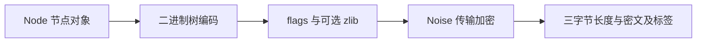
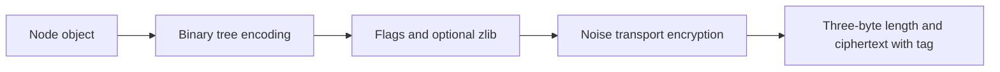

# Protocol Tree Node · 二进制节点与编解码

[首页](../README.md#zh) · [协议目录](README.md#zh) · [中文](#zh) · [English](#en) · [Telegram: @ttjjda](https://t.me/ttjjda)

<a id="zh"></a>

## 中文

Protocol Tree Node 是 WhatsApp 长连接中承载 stanza 的二进制树格式，也常称为 WABinary。它用标签、属性和子节点或字节内容组织数据，通过 token 字典、列表计数、半字节打包和 JID 专用编码减少体积。XML 可以展示树的结构；实际编码直接从节点对象生成字节。

本文依次介绍[协议分层](#zh-layers)、[节点模型](#zh-model)、[列表语法](#zh-lists)、[标记与字典](#zh-tokens)、[字节长度](#zh-binary)、[字符串打包](#zh-packed)、[JID](#zh-jid)、[压缩封装](#zh-envelope)、[读写流程](#zh-algorithms)、[字节示例](#zh-example)、[Python API](#zh-python)、[外部字典](#zh-dictionary)、[精确回写](#zh-preservation)、[错误处理](#zh-errors)和[业务分发](#zh-dispatch)。

<a id="zh-layers"></a>

### 1. 协议分层与数据边界

发送时，节点编码和可选压缩先完成，再进入传输加密与 TCP 帧封装：



接收按相反顺序进行：读满帧、认证解密、处理明文标志、按需解压，再递归恢复节点并进入业务分发。

| 层 | 数据与职责 |
| --- | --- |
| Protocol Tree Node | 标签、属性、JID、子节点列表和叶子字节 |
| 明文封装 | `00 + node_bytes`，或 `02 + zlib(node_bytes)` |
| Noise transport | 用当前方向的密钥和计数器认证加密整个明文封装 |
| TCP 应用帧 | 三字节大端长度，后接密文与 16 字节 GCM 标签 |
| 业务内容 | 节点内的 `enc` 等载荷可能仍需 Signal 端到端解密 |

握手阶段的帧体是 Protobuf `HandshakeMessage`；握手完成后的传输帧解密后才进入这里的节点流程。节点的 `data` 也可能承载 Protobuf，但其具体解释由业务标签决定。注册 HTTP 的 ENC、H 和表单封装有独立流程。

业务结果声明 `format="argo"` 时，节点层保留其原始 `data: bytes`，业务处理器再按原请求关联的 Wire Schema 解码。载荷、Header、schema 选择与精确回写见 [Argo · 二进制格式与编解码](argo.md#zh)。

帧读取见 [TCP 帧协议](tcp-framing.md#zh)，密钥、nonce、AAD 和握手状态见 [Noise 握手与加密传输](noise.md#zh)。

<a id="zh-model"></a>

### 2. 节点模型与内容约束

节点包含四类字段：

| 字段 | 类型 | 规则 |
| --- | --- | --- |
| `tag` | 非空字符串 | 节点名称，如 `iq`、`message`、`receipt` |
| `attrs` | 有序属性序列 | 每项为属性名与字符串、JID 或 null 值；顺序与重复项都应保留 |
| `data` | bytes 或无值 | 任意字节，不要求 UTF-8 |
| `children` | 节点序列或无值 | 递归的子节点列表 |

`data` 和 `children` 只能有一个非 null，即使其中一个是空数组也不能同时设置。它们的空值语义不同：

| 状态 | 规范写入行为 |
| --- | --- |
| `data=None, children=None` | 无 content |
| `data=b""` | 有 content，写入零长度字节 `FC 00` |
| `children=()` | 归一为无 content；再次读取为 `children=None` |
| 非空 `children` | 有 content，写入子节点列表 |

属性值的 null 与空字符串也不同：字符串位置的 `00` 表示 null；允许打包的空属性字符串可写为 `FF 00`。

这种树没有通用 XML DOM 的混合文本与子元素、注释、CDATA、实体或 namespace 解析语义。`xmlns` 在二进制层是普通属性。日志中的 XML 或 Base64 展示也不决定实际传输编码。

<a id="zh-lists"></a>

### 3. 节点语法与列表计数

```text
node := list_header(N)
        tag
        (attribute_name attribute_value) × A
        [content]

N = 1 + 2 × A + C
C = 0：无 content
C = 1：有 content
```

`N` 统计当前层的元素个数。标签占一项，一对属性占两项，整个 content 只占一项。它与节点占用的字节数无关。

| N | 含义 | 属性数 |
| --- | --- | --- |
| 奇数 | 无 content | `(N - 1) / 2` |
| 偶数 | 有 content | `(N - 2) / 2` |

列表头有三种：

| 字节 | 数量 |
| --- | --- |
| `00` | 空列表，0 项 |
| `F8 count8` | 后跟一个无符号字节 |
| `F9 count16_BE` | 后跟两个大端字节 |

规范写入在数量为 0 时用 `00`，1～255 用 `F8`，256～65535 用 `F9`；数量达到 65536 时失败。读取也能接受用较宽头表示的小列表。根节点列表必须至少包含标签，不能用空列表表示空节点。

content 的首个标记为 `00/F8/F9` 时，表示子节点列表，随后按数量递归读取；其他受支持标记表示叶子内容。叶子可读取为原始字节、打包字符串或字典字符串，后两者最终转换成节点的字节内容。规范 writer 对 `data` 始终采用原始字节编码。

节点没有闭合标签，解码器依靠计数确定边界。

<a id="zh-tokens"></a>

### 4. 标记与 token 字典

下表中的数值均为十六进制：

| 标记 | 含义 |
| --- | --- |
| `00` | 列表位置为空列表；字符串位置为 null |
| `01/02` | 保留的流控制位置；`02` 在根节点标签位置表示流结束 |
| `03..EB` | 主表单字节字符串 token |
| `EC..EF index8` | 四页扩展表之一，后跟页内索引 |
| `F4` | interop JID，属性值专用分支 |
| `F7` | 紧凑设备 JID |
| `F8/F9` | 8 位或 16 位计数的列表 |
| `FA` | 普通 JID pair |
| `FB` | 大写十六进制半字节字符串 |
| `FC/FD/FE` | 带 8/20/31 位有效长度的原始字节 |
| `FF` | 数字与部分标点的半字节字符串 |

主表最多 236 个槽位，包含保留的 0、1、2；普通字符串使用槽位 3～235。扩展表最多四页，每页 256 项。数组位置就是协议编号，空槽不可删除，读取不存在或为空的 token 应报错。

例如，若配置中 `single[0x19]="iq"`，字节 `19` 表示 `iq`；若 `dictionaries[1][7]="custom"`，字节 `ED 07` 表示 `custom`。编号含义取决于双方选择的字典。

字符串写入优先查字典，再选择 JID 或文本编码。字典包含重复字符串时，Python writer 按主表、各页依次建立反向索引，以最后一个位置为准；reader 能识别每个有效位置。因此，相同文本可能有多个合法字节表示。

字典是编解码配置，不是随着每条消息自动学习或协商变化的压缩状态。`01` 不作为普通字符串 token 解码，不能仅凭表内的名称把它当作完整流开始格式。

<a id="zh-binary"></a>

### 5. 原始字节与长度头

规范 writer 根据字节长度 `L` 选择：

| L 范围 | 格式 |
| --- | --- |
| `0 ≤ L < 256` | `FC + uint8(L) + bytes` |
| `256 ≤ L < 2^20` | `FD + uint20_BE(L) + bytes`，长度占三字节 |
| `2^20 ≤ L < 2^31` | `FE + uint31_BE(L) + bytes`，长度占四字节 |

`FD` 的首个长度字节只使用低四位；`FE` 的首个长度字节只使用低七位。reader 对其余高位做掩码，默认 writer 将这些高位置零。

```text
FC 03 61 62 63             → 三个字节 "abc"
FD 00 01 00 + 256 bytes    → 长度 256
FE 00 10 00 00 + bytes     → 长度 1,048,576
```

文本长度按 UTF-8 编码后的字节计算。例如 `"节点"` 是 6 字节。原始 `data` 则不经过文本转换，可包含 `00 FF 80` 等任意值。

列表元素数、字段字节长度、压缩前后长度和 TCP 密文帧长度分别计算。内层长度能表示大数据，实际读取和发送仍受资源上限及外层 24 位帧长度约束。

<a id="zh-packed"></a>

### 6. 数字与大写 HEX 打包

允许 packing 的字符串在未命中字典且 UTF-8 长度小于 128 时，先尝试 `FF`，再尝试 `FB`；都不能表示时，回退原始字节编码。

| 标记 | 每个半字节的字符映射 |
| --- | --- |
| `FF` | `0..9 → 0..9`，`A → -`，`B → .`，`C → :` |
| `FB` | `0..9 → 0..9`，`A..F → A..F` |

`FF` 的 `D/E/F` 不能作为有效正文字符。小写 HEX 不会自动转成大写。每字节先放高半字节，再放低半字节：

```text
marker | length_byte | packed_bytes
packed_byte_count = length_byte & 0x7F
odd = length_byte >> 7
character_count = 2 × packed_byte_count - odd
```

奇数字符串的最后一个低半字节由规范 writer 填 `F`，并通过 odd 位省略；reader 忽略被省略半字节的实际值。

| 文本 | 编码 |
| --- | --- |
| `12345` | `FF 83 12 34 5F` |
| `12:34` | `FF 83 12 C3 4F` |
| `12-.` | `FF 02 12 AB` |
| `ABCDEF` | `FB 03 AB CD EF` |
| `abc` | `FC 03 61 62 63` |
| `A:B` | `FC 03 41 3A 42` |

上述示例假定文本未命中字典。标签和属性名不启用半字节打包；属性字符串值与 JID user 可以启用；节点 `data` 始终写为原始字节。

reader 的头格式最多容纳 254 个字符，与规范 writer 的“小于 128 字节才选择 packing”是两个限制。读取合法的较长打包串后，默认重新写入可能改用原始字节。

<a id="zh-jid"></a>

### 7. JID 专用编码

JID 将用户、域、设备号或 integrator 分开编码，避免反复传输完整地址文本。JID 的 flags 与明文包 flags 是不同字段。

#### 普通 pair：FA

```text
FA | encoded_user_or_00 | encoded_server
```

user 可用字典或 packing，server 可用字典或 UTF-8 原始字节。空 user 的规范写入使用 null；server 必须非空。显示形式通常为 `user@server`，user 为空时只显示 server。

#### 紧凑设备 JID：F7

```text
F7 | flags8 | device8 | encoded_user
```

`flags & 0x81` 决定域：

| 掩码结果 | server |
| --- | --- |
| `00` | `s.whatsapp.net` |
| `01` | `lid` |
| `80` | `hosted` |
| `81` | `hosted.lid` |

完整 flags 字节需要保留，不能只留下上述两个位。设备号为 0～255；非零时，文本显示为 `user:device@server`。hosted 位与设备号 99 的预期不一致可以触发诊断，不应一概视为格式硬拒绝。

#### interop JID：F4

```text
F4 | encoded_user | device16_BE | integrator16_BE | domain8
```

| domain | 规则 |
| --- | --- |
| `00` | `interop`；user 必须非空，device 与 integrator 各为 uint16 |
| `02` | `interop.g.us`；device 与 integrator 都必须为 0 |
| 其他 | 格式错误 |

个人 interop JID 的显示形式为 `integrator-user[:device]@interop`，群组为 `user@interop.g.us`。`F4` 位于节点属性值的专用解析分支，不能简单当作任意字符串标记处理。

Python 使用显式类型选择编码：

```python
from protocol_tree_node import JID

ordinary = JID("123", "s.whatsapp.net")                       # FA
device = JID("123", "lid", device=2, flags=1)                # F7
hosted = JID("123", "hosted", device=99, flags=128)           # F7
interop = JID("123", "interop", device=258, integrator=513)   # F4
group = JID("group", "interop.g.us", integrator=0)           # F4
```

字符串 `"123@s.whatsapp.net"` 在 Python API 中仍是字符串，需要 tuple 编码时应传 `JID`。业务侧按属性名识别 JID 类型的规则由调用方适配。`integrator is not None` 才选择 F4；单独设置 interop 域名仍可表示 FA。

F7 省略 flags 且 device 非零时，writer 根据 server 推导 flags，reader 则返回完整 flags。若要求构造对象与读回对象直接相等，应显式提供 flags。FA 的空 user 读回归一为 `None`。

<a id="zh-envelope"></a>

### 8. 明文标志、zlib 与流结束

```text
未压缩：00 | node_bytes
已压缩：02 | zlib(node_bytes)
```

标志字节位于 Noise 加密以内、zlib 数据以外。压缩使用带 zlib 包装的 DEFLATE；gzip 或 raw DEFLATE 不能直接替代。压缩是调用方明确选择的操作，不要求每条节点都压缩，也不自动比较压缩前后的长度。

`flags & 0x02` 表示解压后续内容，`flags & 0x01` 表示 stanza 分片；服务器到客户端的节点读取路径拒绝分片。Python API 仅接受 flags `00/02`，也拒绝其他未知位。

流结束使用独立控制值：

```text
纯节点：F8 01 02
明文包：00 F8 01 02
```

Python 将其表示为 `STREAM_END`，与空节点、无 content 和空字节内容区分。reader 要求它是只含一个元素的根列表；不能放在子节点中。

<a id="zh-algorithms"></a>

### 9. 编码与解码流程

规范编码的步骤为：

1. 检查节点模型、深度、节点数量和属性数量。
2. 按 `1 + 2 × 属性数 + 是否有内容` 写列表头。
3. 写标签，再按原顺序写每个属性名和值；普通文本先查字典，允许时尝试 packing，再回退 UTF-8 字节；显式 JID 使用专用格式。
4. 写原始 data，或子列表计数及每个递归子节点。
5. 按接口选项增加 flags 和可选 zlib，交给上层进行 Noise 加密与帧封装。

解码的步骤为：

1. 确认输入是纯节点还是已解密的 flags 封装；封装模式先检查 flags 并按需解压。
2. 读取根列表数量与 tag；识别流结束。
3. 根据列表数量计算属性数，按顺序读取名称和值；JID 属性保留为结构化对象。
4. 根据奇偶判断有无 content；有内容时，区分子节点列表与叶子字节/文本。
5. 递归恢复整棵树，检查输入已经全部消耗，再返回对象。

一次 `read` 处理一个完整根节点或流结束值。TCP 的半包、粘包和连续帧由上层缓冲解决，不能把缺字节视为节点正常结束。

<a id="zh-example"></a>

### 10. 逐字节示例

下面是用于说明结构的合成树：

```xml
<iq id="12345" type="get">
  <ping xmlns="urn:xmpp:ping"/>
</iq>
```

本例的字典配置含 `19=iq`、`08=id`、`04=type`、`29=get`、`56=ping`、`16=xmlns`、`2B=urn:xmpp:ping`。对应未压缩明文共 19 字节：

```text
00 F8 06 19 08 FF 83 12 34 5F 04 29 F8 01 F8 03 56 16 2B
```

| 字节 | 含义 |
| --- | --- |
| `00` | 未压缩 flags |
| `F8 06` | 根列表 6 项：tag、两对属性、content |
| `19` | iq |
| `08 FF 83 12 34 5F` | id=12345 |
| `04 29` | type=get |
| `F8 01` | content 是一个子节点的列表 |
| `F8 03` | 子节点 3 项：tag、一对属性，无 content |
| `56 16 2B` | ping 与 xmlns=urn:xmpp:ping |

这些字节没有 XML 的尖括号、属性引号或闭合标签。放入 TCP 前，还需使用当前会话的传输密钥加密，并增加密文长度头。

<a id="zh-python"></a>

### 11. Python read/write API

`protocol_tree_node` 提供 `Codec`、`Node`、`Attribute`、`JID`、`TokenDictionary`、`Limits`、`ProtocolError` 和 `STREAM_END`。Python 3.10 及以上运行时只需标准库。

```python
from protocol_tree_node import Attribute, Codec, JID, Node, TokenDictionary

codec = Codec(TokenDictionary.bundled())
node = Node(
    "message",
    attrs=(
        Attribute("to", JID("123456789", "s.whatsapp.net")),
        Attribute("id", "ABCDEF"),
        Attribute("type", "text"),
    ),
    children=(Node("enc", attrs={"v": "2"}, data=b"\x00\xff\x80"),),
)

packet = codec.write(node)
assert packet[0] == 0
assert codec.read(packet) == node

compressed = codec.write(node, compress=True)
assert compressed[0] == 2
assert codec.read(compressed) == node

raw = codec.write(node, framed=False)
assert codec.read(raw, framed=False) == node
```

所有号码与载荷均为合成示例。`enc` 的 data 在这里仅演示字节容器，不代表有效的端到端密文。

| 参数 | 作用 |
| --- | --- |
| `framed=True` | 默认值，读写 `flags + 节点或 zlib 数据` 的加密前明文 |
| `framed=False` | 只读写纯节点字节 |
| `compress=True` | 写入 `02 + zlib(node_bytes)`；要求 framed=True |
| `preserve_wire=True` | 读取时记录编码布局，写入时按该布局重编码 |

这里的 framed 不包含三字节 TCP 长度头、Noise 密文或 GCM 标签。API 不打开网络连接，不推进 Noise 计数器，也不解密节点内部的业务载荷。

顶层函数与实例方法具有对应参数：

```python
from protocol_tree_node import Node, TokenDictionary, read, write

table = TokenDictionary.bundled()
raw = write(Node("iq"), dictionary=table, framed=False)
assert read(raw, dictionary=table, framed=False) == Node("iq")
```

每次调用创建独立读写状态，固定配置的 Codec 可以并发复用；调用期间不要替换其 dictionary 或 limits。

`Node.to_dict()` 和 `Node.from_dict()` 提供 JSON 友好表示：attrs 是 `[name, value]` 列表，JID 值为 `{"jid": {...}}`，data 是标准 Base64 文本或 null。Base64 属于此 JSON 表示层，不会改变二进制协议的 data 编码：

```python
from protocol_tree_node import Attribute, JID, Node

node = Node(
    "message",
    attrs=(Attribute("to", JID("123", "s.whatsapp.net")),),
    data=b"\x00\xff\x80",
)
document = node.to_dict()
assert document["data"] == "AP+A"
assert Node.from_dict(document) == node
```

<a id="zh-dictionary"></a>

### 12. 外部字典配置

字典可以从 JSON、mapping 或数组注入，修改编号不需要改动编解码逻辑。以下为独立的教学配置，编号与上一节示例分开：

```json
{
  "single": [null, null, null, "iq", "id"],
  "dictionaries": [["ping", "xmlns", "urn:xmpp:ping"]]
}
```

将配置保存为 `my-tokens.json` 后，可使用 `TokenDictionary.from_json("my-tokens.json")`。等价的内存注入为：

```python
from protocol_tree_node import Codec, Node, TokenDictionary

config = {
    "single": [None, None, None, "iq", "id"],
    "dictionaries": [["ping", "xmlns", "urn:xmpp:ping"]],
}
table = TokenDictionary.from_mapping(config)
codec = Codec(table)
assert codec.write(Node("iq"), framed=False) == bytes.fromhex("F8 01 03")
assert codec.write(Node("ping"), framed=False) == bytes.fromhex("F8 01 EC 00")

same_table = TokenDictionary(config["single"], config["dictionaries"])
assert Codec(same_table).read(bytes.fromhex("F8 01 03"), framed=False) == Node("iq")
```

主表和扩展页允许短数组，空槽可写 null，但不能移动已有编号。构造器复制输入数组，公开表为只读 tuple，后续修改原配置列表不会改变当前字典。`TokenDictionary.bundled()` 是显式选用随包表的便捷入口，Codec 不会隐式加载全局默认表。

发送端与接收端必须使用编号含义一致的配置。错误字典可能让结构合法的字节解成错误名称，不能指望所有字典不匹配都触发异常。

<a id="zh-preservation"></a>

### 13. 规范写入与逐字节回写

相同节点内容可以有多种合法编码：较宽的列表/长度头、重复词的不同 token、叶子内容的 token 或 packing、显式空子列表，以及被 reader 忽略的长度高位或奇数 padding。

默认 writer 按自身规则重新选择编码。因此，对象语义相同不保证 `write(read(raw)) == raw`。需要保持节点编码时，读取和写入都开启 preserve_wire：

```python
from protocol_tree_node import Codec, Node, TokenDictionary

codec = Codec(TokenDictionary([None, None, None, "node"]))
# F9: wide list header; FD: wide byte length with ignored high bits.
raw = bytes.fromhex("F9 00 02 03 FD A0 00 03 31 32 33")
node = codec.read(raw, framed=False, preserve_wire=True)
assert node == Node("node", data=b"123")
assert codec.write(node, framed=False, preserve_wire=True) == raw

canonical = codec.write(node, framed=False)
assert canonical == bytes.fromhex("F8 02 03 FC 03 31 32 33")
assert canonical != raw
```

保留模式记录列表标记、token 位置、长度宽度与被忽略高位、packing 类型和 padding、JID 编码以及子列表布局。它从当前节点字段重编码，不保存整份原报文再直接返回。内部布局不参与 Node 的相等比较。

| 操作 | 结果 |
| --- | --- |
| 保持字段和字典编号含义 | 可按保留布局还原节点字节 |
| 用 `dataclasses.replace` 修改仍适配布局的值 | 重算长度与内容，输出新字节 |
| 增减属性、改变 content 类型、值超出保留宽度或字母表 | 抛 ProtocolError；可显式改用规范写入 |
| 更换字典且原 token 含义改变 | 抛 ProtocolError |
| 手工构造节点，或经过 to_dict/from_dict | 没有内部布局，不能直接使用保留写入 |

属性位置保留结构化 JID；其他文本位置若 JID 转成文本时已经丢失信息，保留写入会拒绝无法恢复的表示。

保留范围是节点层。framed 与 compress 仍由调用方指定；读取压缩包不会自动让下一次写入也压缩。即使解压后节点字节完全一致，不同 zlib 压缩参数仍可能产生不同压缩位流，完整压缩包的逐字节相等需另行判断。

<a id="zh-errors"></a>

### 14. 错误处理与资源限制

Python reader 要求完整消耗一个根节点的输入。截断、未知 token、空字典槽、缺失名称、非法 JID、非法 UTF-8 文本、尾随字节及超限输入都抛 `ProtocolError`，它是 `ValueError` 的子类。raw data 不要求有效 UTF-8。

接口区分输入层次：read 接受 bytes、bytearray 或 memoryview；错误的参数类型可能抛 TypeError；非法模型、配置或选项可能抛 ValueError，例如同时设置 data/children，或 `compress=True, framed=False`。

默认资源限制如下：

| 配置 | 默认值 | 作用 |
| --- | --- | --- |
| `max_bytes` | 16 × 1024 × 1024 | 输入、展开后的节点数据及输出的字节上限 |
| `max_depth` | 128 | 根节点计入深度；可配置值最高为 256 |
| `max_nodes` | 100000 | 整棵树的节点数，包含根 |
| `max_attributes` | 32767 | 单个节点的属性数；同时受列表计数范围约束 |

```python
from protocol_tree_node import Codec, Limits, ProtocolError, TokenDictionary

codec = Codec(TokenDictionary.bundled(), limits=Limits(
    max_bytes=16 * 1024 * 1024,
    max_depth=128,
    max_nodes=100_000,
    max_attributes=32_767,
))
try:
    codec.read(b"\x00\xf8")
except ProtocolError:
    pass
else:
    raise AssertionError("truncated input was accepted")
```

zlib 以有输出上限的方式展开，并检查结束标记、未消耗数据和尾随数据，避免先无界解压再检查。Python API 还明确拒绝未知 flags、嵌套流结束、流结束附带额外元素和 zlib 后缀；不能把这些严格校验推广为每个业务接收入口完全相同的容错规则。

<a id="zh-dispatch"></a>

### 15. 节点解析与业务分发

完整恢复树后，上层按 tag 进入 `iq`、`message`、`receipt`、`notification`、`call`、`presence`、`chatstate`、`ack` 或 `ib` 等处理流程。IQ 的 result/error 用 id 查找并移除对应的等待回调，再交付结果或解析错误；错误属性、超时和重试由相应业务维护。

编解码成功只说明能够恢复数据结构。它不自动证明业务字段有效、服务器接受请求、登录成功或聊天内容已经解密。实现时分别维护传输状态、树结构、JID 类型与业务状态。

### 相关主题

[TCP 帧协议](tcp-framing.md#zh) · [Noise 握手与加密传输](noise.md#zh) · [Argo · 二进制格式与编解码](argo.md#zh) · [消息发送与接收](../messaging/README.md#zh) · [端到端加密与密钥管理](../encryption/README.md#zh)

<a id="en"></a>

## English

Protocol Tree Node is the binary tree format that carries stanzas over WhatsApp's persistent connection, also commonly called WABinary. Tags, attributes, and either child nodes or byte content organize the data. Token dictionaries, list counts, nibble packing, and dedicated JID encodings reduce its size. XML can display the tree; the encoder produces bytes directly from node objects.

This article covers [protocol layers](#en-layers), the [node model](#en-model), [list grammar](#en-lists), [markers and tokens](#en-tokens), [binary lengths](#en-binary), [packed strings](#en-packed), [JIDs](#en-jid), the [compressed envelope](#en-envelope), [read/write steps](#en-algorithms), a [byte example](#en-example), the [Python API](#en-python), [external dictionaries](#en-dictionary), [exact rewriting](#en-preservation), [error handling](#en-errors), and [business dispatch](#en-dispatch).

<a id="en-layers"></a>

### 1. Protocol Layers and Data Boundaries

Sending encodes the node and applies optional compression before transport encryption and TCP framing:



Receiving reverses this order: read the complete frame, authenticate and decrypt, process plaintext flags, decompress if needed, then recursively reconstruct the node and dispatch it.

| Layer | Data and responsibility |
| --- | --- |
| Protocol Tree Node | Tags, attributes, JIDs, child lists, and leaf bytes |
| Plaintext envelope | `00 + node_bytes` or `02 + zlib(node_bytes)` |
| Noise transport | Authenticated encryption of the entire envelope with directional keys and counters |
| TCP application frame | Three-byte big-endian length followed by ciphertext and a 16-byte GCM tag |
| Business content | Payloads such as `enc` may still require Signal end-to-end decryption |

Handshake frames carry a Protobuf `HandshakeMessage`. The node pipeline applies to decrypted transport frames after the handshake. A node's data can also carry Protobuf, with interpretation determined by its business tag. Registration HTTP ENC, H, and form packaging follow a separate process.

When a business result declares `format="argo"`, the node layer retains its raw `data: bytes`; the business handler decodes it with the Wire Schema associated with the original request. See [Argo · Binary Format and Encoding](argo.md#en) for payloads, headers, schema selection and exact rewriting.

See [TCP Framing](tcp-framing.md#en) for frame reading and [Noise Handshakes and Encrypted Transport](noise.md#en) for keys, nonces, AAD, and handshake state.

<a id="en-model"></a>

### 2. Node Model and Content Constraints

A node has four fields:

| Field | Type | Rule |
| --- | --- | --- |
| `tag` | Nonempty string | Node name, such as iq, message, or receipt |
| `attrs` | Ordered attribute sequence | Each name has a string, JID, or null value; preserve order and duplicates |
| `data` | Bytes or absent | Arbitrary bytes; UTF-8 is not required |
| `children` | Node sequence or absent | Recursive child list |

Only one of data and children may be non-null, even when either is an empty array. Empty states differ:

| State | Canonical writing |
| --- | --- |
| `data=None, children=None` | No content |
| `data=b""` | Content exists; write zero-length bytes `FC 00` |
| `children=()` | Normalize to no content; reading it back gives children=None |
| Nonempty children | Content exists; write a child list |

A null attribute value also differs from empty text: `00` in a string position means null, while an empty attribute string can use `FF 00` where packing is enabled.

This tree has no general XML DOM semantics for mixed text and elements, comments, CDATA, entities, or namespace parsing. At the binary layer, xmlns is an ordinary attribute. XML or Base64 shown in logs does not determine the transmitted encoding.

<a id="en-lists"></a>

### 3. Node Grammar and List Counts

```text
node := list_header(N)
        tag
        (attribute_name attribute_value) × A
        [content]

N = 1 + 2 × A + C
C = 0: no content
C = 1: content exists
```

N counts elements at the current level. The tag occupies one element, each attribute pair occupies two, and the entire content occupies one. N does not measure byte length.

| N | Meaning | Attribute count |
| --- | --- | --- |
| Odd | No content | `(N - 1) / 2` |
| Even | Content exists | `(N - 2) / 2` |

There are three list headers:

| Bytes | Count |
| --- | --- |
| `00` | Empty list, zero elements |
| `F8 count8` | One following unsigned byte |
| `F9 count16_BE` | Two following big-endian bytes |

Canonical writing uses 00 for zero, F8 for 1–255, and F9 for 256–65535; counts of 65536 or more fail. Reading also accepts wider headers for small lists. A root node list must contain at least its tag; an empty list cannot represent an empty node.

If content starts with 00/F8/F9, it is a child list followed by that many recursively encoded nodes. Other supported markers represent leaf content. Readers accept raw bytes, packed strings, or dictionary strings; the latter two become the node's byte content. The canonical writer always encodes data as raw bytes.

There are no closing tags. Counts determine node boundaries.

<a id="en-tokens"></a>

### 4. Markers and Token Dictionaries

All values in this table are hexadecimal:

| Marker | Meaning |
| --- | --- |
| `00` | Empty list in a list position; null in a string position |
| `01/02` | Reserved stream-control positions; 02 at the root tag ends the stream |
| `03..EB` | Single-byte string token in the main table |
| `EC..EF index8` | One of four dictionary pages plus a byte index |
| `F4` | Interop JID in the attribute-value branch |
| `F7` | Compact device JID |
| `F8/F9` | List with an 8-bit or 16-bit count |
| `FA` | Ordinary JID pair |
| `FB` | Uppercase hexadecimal nibble string |
| `FC/FD/FE` | Raw bytes with an effective 8/20/31-bit length |
| `FF` | Nibble string containing digits and selected punctuation |

The main table has at most 236 slots, including reserved slots 0, 1, and 2. Ordinary strings use slots 3–235. There are at most four extension pages, each with 256 slots. Array positions are protocol IDs; retain holes and reject missing or empty token entries.

For example, if single[0x19] is iq, byte 19 means iq. If dictionaries[1][7] is custom, bytes ED 07 mean custom. Token meanings depend on the dictionary selected by both ends.

String writing checks the dictionary before choosing JID or text encoding. When strings occur more than once, the Python writer builds its reverse index in main-table and page order, selecting the final occurrence. The reader recognizes every valid occurrence, so identical text can have several valid byte representations.

The dictionary is codec configuration, not compression state learned or negotiated for each message. 01 is not decoded as an ordinary string token; its table label alone does not define a complete stream-start format.

<a id="en-binary"></a>

### 5. Raw Bytes and Length Headers

The canonical writer selects a header using byte length L:

| L range | Format |
| --- | --- |
| `0 ≤ L < 256` | `FC + uint8(L) + bytes` |
| `256 ≤ L < 2^20` | `FD + uint20_BE(L) + bytes`, using three length bytes |
| `2^20 ≤ L < 2^31` | `FE + uint31_BE(L) + bytes`, using four length bytes |

FD uses only the low four bits of its first length byte. FE uses only the low seven bits. Readers mask the remaining high bits; the default writer emits them as zero.

```text
FC 03 61 62 63             → three bytes: "abc"
FD 00 01 00 + 256 bytes    → length 256
FE 00 10 00 00 + bytes     → length 1,048,576
```

Text lengths count UTF-8 bytes. For example, 节点 occupies six bytes. Raw data bypasses text conversion and can contain arbitrary values such as 00 FF 80.

List counts, field byte lengths, compressed/uncompressed sizes, and TCP ciphertext lengths are separate quantities. Large inner lengths remain subject to resource limits and the outer 24-bit frame length.

<a id="en-packed"></a>

### 6. Digit and Uppercase HEX Packing

When packing is enabled, text absent from the dictionary with a UTF-8 length below 128 first tries FF, then FB. If neither alphabet can represent it, writing falls back to raw bytes.

| Marker | Nibble-to-character mapping |
| --- | --- |
| `FF` | `0..9 → 0..9`, `A → -`, `B → .`, `C → :` |
| `FB` | `0..9 → 0..9`, `A..F → A..F` |

D/E/F are invalid as actual character nibbles under FF. Lowercase HEX is not automatically uppercased. Each byte stores its high nibble first:

```text
marker | length_byte | packed_bytes
packed_byte_count = length_byte & 0x7F
odd = length_byte >> 7
character_count = 2 × packed_byte_count - odd
```

For odd character counts, the canonical writer fills the final low nibble with F and sets odd to omit it. The reader ignores that omitted nibble's actual value.

| Text | Encoding |
| --- | --- |
| `12345` | `FF 83 12 34 5F` |
| `12:34` | `FF 83 12 C3 4F` |
| `12-.` | `FF 02 12 AB` |
| `ABCDEF` | `FB 03 AB CD EF` |
| `abc` | `FC 03 61 62 63` |
| `A:B` | `FC 03 41 3A 42` |

These examples assume no dictionary match. Tags and attribute names do not enable packing; attribute string values and JID users can. Node data always uses raw bytes when written.

The reader's header can represent up to 254 characters, while the canonical writer chooses packing only below 128 input bytes. A longer valid packed string can therefore be rewritten as raw bytes by default.

<a id="en-jid"></a>

### 7. Dedicated JID Encodings

JIDs encode user, domain, device, or integrator separately, reducing repeated full address text. JID flags and plaintext-envelope flags are different fields.

#### Ordinary Pair: FA

```text
FA | encoded_user_or_00 | encoded_server
```

The user can use dictionary tokens or packing; the server can use tokens or UTF-8 raw bytes. Canonical writing encodes an empty user as null. The server must be nonempty. Text usually appears as user@server, or just server when the user is empty.

#### Compact Device JID: F7

```text
F7 | flags8 | device8 | encoded_user
```

flags & 0x81 determines the domain:

| Masked value | Server |
| --- | --- |
| `00` | `s.whatsapp.net` |
| `01` | `lid` |
| `80` | `hosted` |
| `81` | `hosted.lid` |

Preserve the full flags byte, including other bits. Device numbers range from 0 to 255; a nonzero device appears as user:device@server. A mismatch between the hosted flag and the expected device 99 can produce a diagnostic rather than an unconditional format rejection.

#### Interop JID: F4

```text
F4 | encoded_user | device16_BE | integrator16_BE | domain8
```

| Domain | Rule |
| --- | --- |
| `00` | interop; user must be nonempty, device and integrator are uint16 |
| `02` | interop.g.us; device and integrator must both be zero |
| Other | Format error |

Personal interop addresses render as integrator-user[:device]@interop; groups render as user@interop.g.us. F4 is handled by the node attribute-value branch, not as a general string marker.

Python selects these formats through explicit types:

```python
from protocol_tree_node import JID

ordinary = JID("123", "s.whatsapp.net")                       # FA
device = JID("123", "lid", device=2, flags=1)                # F7
hosted = JID("123", "hosted", device=99, flags=128)           # F7
interop = JID("123", "interop", device=258, integrator=513)   # F4
group = JID("group", "interop.g.us", integrator=0)           # F4
```

The Python API keeps "123@s.whatsapp.net" as a string; supply JID for tuple encoding. Business rules that infer JID types from attribute names belong in the caller's adapter. F4 is selected only when integrator is not None; an interop domain alone can still represent FA.

For F7 with a nonzero device and omitted flags, the writer derives flags from the server; the reader returns explicit flags. Supply flags explicitly when direct equality with the constructed object is required. An empty FA user reads back as None.

<a id="en-envelope"></a>

### 8. Plaintext Flags, zlib, and Stream End

```text
Uncompressed: 00 | node_bytes
Compressed:   02 | zlib(node_bytes)
```

The flags byte is inside Noise encryption and outside the zlib stream. Compression uses zlib-wrapped DEFLATE; gzip or raw DEFLATE cannot directly replace it. Compression is an explicit caller choice, with no requirement to compress every node or automatically compare sizes.

flags & 0x02 requests decompression of the following bytes. flags & 0x01 indicates stanza fragmentation, which the server-to-client node-reading path rejects. The Python API accepts only flags 00/02 and also rejects other unknown bits.

Stream end has a separate control value:

```text
Raw node:           F8 01 02
Plaintext envelope: 00 F8 01 02
```

Python represents this as STREAM_END, distinct from an empty node, absent content, or empty bytes. Reading requires a singleton root list; stream end cannot appear as a child.

<a id="en-algorithms"></a>

### 9. Encoding and Decoding Steps

Canonical encoding proceeds as follows:

1. Check the model, depth, total node count, and attribute count.
2. Write the list header for 1 + 2 × attribute count + content presence.
3. Write the tag and each ordered attribute name/value. Text checks tokens, then packing where allowed, then UTF-8 bytes; explicit JIDs use their dedicated format.
4. Write raw data, or the child count followed by each recursively encoded node.
5. Add flags and optional zlib as requested, then pass the result to the upper layer for Noise encryption and framing.

Decoding proceeds as follows:

1. Identify raw-node input versus a decrypted flags envelope; in envelope mode, validate flags and decompress if needed.
2. Read the root list count and tag, recognizing stream end.
3. Derive the attribute count and read names/values in order, retaining JID attributes as structured objects.
4. Use parity to determine content presence, then distinguish a child list from leaf bytes/text.
5. Recursively reconstruct the complete tree and require full input consumption before returning.

One read processes one complete root node or stream-end value. TCP buffering handles incomplete chunks and consecutive frames; missing bytes cannot be treated as a normal node boundary.

<a id="en-example"></a>

### 10. Byte-by-Byte Example

This synthetic tree illustrates the structure:

```xml
<iq id="12345" type="get">
  <ping xmlns="urn:xmpp:ping"/>
</iq>
```

The example dictionary contains 19=iq, 08=id, 04=type, 29=get, 56=ping, 16=xmlns, and 2B=urn:xmpp:ping, all hexadecimal. Its uncompressed plaintext contains 19 bytes:

```text
00 F8 06 19 08 FF 83 12 34 5F 04 29 F8 01 F8 03 56 16 2B
```

| Bytes | Meaning |
| --- | --- |
| `00` | Uncompressed flags |
| `F8 06` | Six root elements: tag, two attribute pairs, content |
| `19` | iq |
| `08 FF 83 12 34 5F` | id=12345 |
| `04 29` | type=get |
| `F8 01` | Content is a one-child list |
| `F8 03` | Three child elements: tag and one attribute pair, no content |
| `56 16 2B` | ping and xmlns=urn:xmpp:ping |

There are no XML angle brackets, attribute quotes, or closing tags in these bytes. TCP transmission still requires encryption with the current session's transport key and a ciphertext length prefix.

<a id="en-python"></a>

### 11. Python read/write API

protocol_tree_node exports Codec, Node, Attribute, JID, TokenDictionary, Limits, ProtocolError, and STREAM_END. It requires Python 3.10 or later and only the standard library at runtime.

```python
from protocol_tree_node import Attribute, Codec, JID, Node, TokenDictionary

codec = Codec(TokenDictionary.bundled())
node = Node(
    "message",
    attrs=(
        Attribute("to", JID("123456789", "s.whatsapp.net")),
        Attribute("id", "ABCDEF"),
        Attribute("type", "text"),
    ),
    children=(Node("enc", attrs={"v": "2"}, data=b"\x00\xff\x80"),),
)

packet = codec.write(node)
assert packet[0] == 0
assert codec.read(packet) == node

compressed = codec.write(node, compress=True)
assert compressed[0] == 2
assert codec.read(compressed) == node

raw = codec.write(node, framed=False)
assert codec.read(raw, framed=False) == node
```

All numbers and payloads are synthetic. The enc data illustrates a byte container rather than valid end-to-end ciphertext.

| Option | Meaning |
| --- | --- |
| `framed=True` | Default; read/write the pre-encryption flags + node or zlib envelope |
| `framed=False` | Read/write raw node bytes only |
| `compress=True` | Write 02 + zlib(node_bytes); requires framed=True |
| `preserve_wire=True` | Record encoding layout when reading; use it when rewriting |

Here framed excludes the three-byte TCP prefix, Noise ciphertext, and GCM tag. The API opens no network connection, advances no Noise counters, and performs no business-payload decryption.

Top-level functions expose corresponding options:

```python
from protocol_tree_node import Node, TokenDictionary, read, write

table = TokenDictionary.bundled()
raw = write(Node("iq"), dictionary=table, framed=False)
assert read(raw, dictionary=table, framed=False) == Node("iq")
```

Each call creates independent read/write state. A Codec with fixed configuration can be reused concurrently; do not replace its dictionary or limits during calls.

Node.to_dict() and Node.from_dict() provide a JSON-friendly representation: attrs is a list of [name, value] pairs, JIDs use {"jid": {...}}, and data is standard Base64 text or null. This Base64 belongs to the JSON representation and does not change binary data encoding:

```python
from protocol_tree_node import Attribute, JID, Node

node = Node(
    "message",
    attrs=(Attribute("to", JID("123", "s.whatsapp.net")),),
    data=b"\x00\xff\x80",
)
document = node.to_dict()
assert document["data"] == "AP+A"
assert Node.from_dict(document) == node
```

<a id="en-dictionary"></a>

### 12. External Dictionary Configuration

Dictionaries can be injected from JSON, mappings, or arrays without changing codec logic. This separate teaching configuration uses different IDs from the earlier byte example:

```json
{
  "single": [null, null, null, "iq", "id"],
  "dictionaries": [["ping", "xmlns", "urn:xmpp:ping"]]
}
```

Save it as my-tokens.json and load it with TokenDictionary.from_json("my-tokens.json"). Equivalent in-memory injection:

```python
from protocol_tree_node import Codec, Node, TokenDictionary

config = {
    "single": [None, None, None, "iq", "id"],
    "dictionaries": [["ping", "xmlns", "urn:xmpp:ping"]],
}
table = TokenDictionary.from_mapping(config)
codec = Codec(table)
assert codec.write(Node("iq"), framed=False) == bytes.fromhex("F8 01 03")
assert codec.write(Node("ping"), framed=False) == bytes.fromhex("F8 01 EC 00")

same_table = TokenDictionary(config["single"], config["dictionaries"])
assert Codec(same_table).read(bytes.fromhex("F8 01 03"), framed=False) == Node("iq")
```

Short tables and pages are allowed; null marks holes, but existing IDs must not shift. Construction copies input arrays and exposes read-only tuples, so later mutations to the original lists do not affect the dictionary. TokenDictionary.bundled() explicitly selects the packaged table; Codec has no implicit global default.

Both ends need matching ID meanings. A wrong dictionary can decode structurally valid bytes into incorrect names, so mismatches do not necessarily raise errors.

<a id="en-preservation"></a>

### 13. Canonical Writing and Exact Rewriting

Equivalent node content can use wider list/length headers, alternative duplicate tokens, token or packed leaf content, explicit empty child lists, or ignored length bits and odd padding.

The default writer selects encodings according to its own rules. Semantic equality therefore does not guarantee write(read(raw)) == raw. To retain node encoding choices, enable preserve_wire for both operations:

```python
from protocol_tree_node import Codec, Node, TokenDictionary

codec = Codec(TokenDictionary([None, None, None, "node"]))
# F9: wide list header; FD: wide byte length with ignored high bits.
raw = bytes.fromhex("F9 00 02 03 FD A0 00 03 31 32 33")
node = codec.read(raw, framed=False, preserve_wire=True)
assert node == Node("node", data=b"123")
assert codec.write(node, framed=False, preserve_wire=True) == raw

canonical = codec.write(node, framed=False)
assert canonical == bytes.fromhex("F8 02 03 FC 03 31 32 33")
assert canonical != raw
```

Preservation records list markers, token positions, length widths and ignored high bits, packing kinds and padding, JID encodings, and child-list layouts. It re-encodes current fields rather than retaining and returning an original packet. Internal layout does not participate in Node equality.

| Operation | Result |
| --- | --- |
| Keep fields and token meanings unchanged | Restore node bytes using the saved layout |
| Use dataclasses.replace to edit a value that still fits | Recompute lengths/content and emit new bytes |
| Change attribute count/content kind, or exceed a saved width/alphabet | ProtocolError; explicitly choose canonical writing if desired |
| Change the meaning of a preserved dictionary token | ProtocolError |
| Construct a node manually or pass it through to_dict/from_dict | No internal layout; preserved writing is unavailable |

Attributes retain structured JIDs. If a JID in another text position has lost information while rendering, preservation rejects representations that cannot be reconstructed.

Preservation applies to the node layer. Callers still select framed and compress; reading compressed input does not make subsequent writes compressed automatically. Identical decompressed node bytes can produce different zlib streams under different compression parameters, so complete compressed-packet equality must be checked separately.

<a id="en-errors"></a>

### 14. Errors and Resource Limits

The Python reader requires full input consumption for one root node. Truncation, unknown tokens, empty slots, missing names, invalid JIDs, invalid UTF-8 text, trailing bytes, and exceeded limits raise ProtocolError, a ValueError subclass. Raw data has no UTF-8 requirement.

Input layers have distinct errors: read accepts bytes, bytearray, or memoryview. Incorrect parameter types can raise TypeError. Invalid models, configurations, or options can raise ValueError, such as simultaneous data/children or compress=True with framed=False.

Default resource limits are:

| Option | Default | Meaning |
| --- | --- | --- |
| `max_bytes` | 16 × 1024 × 1024 | Byte limit for input, expanded node data, and output |
| `max_depth` | 128 | Includes the root; configurable up to 256 |
| `max_nodes` | 100000 | Total nodes, including the root |
| `max_attributes` | 32767 | Per-node attributes, also constrained by list-count capacity |

```python
from protocol_tree_node import Codec, Limits, ProtocolError, TokenDictionary

codec = Codec(TokenDictionary.bundled(), limits=Limits(
    max_bytes=16 * 1024 * 1024,
    max_depth=128,
    max_nodes=100_000,
    max_attributes=32_767,
))
try:
    codec.read(b"\x00\xf8")
except ProtocolError:
    pass
else:
    raise AssertionError("truncated input was accepted")
```

zlib expansion enforces an output bound and checks EOF, unconsumed input, and trailing data rather than decompressing without limits first. The Python API also rejects unknown flags, nested stream end, extra stream-end elements, and zlib suffixes. These strict checks do not imply identical tolerance rules at every business receive entry point.

<a id="en-dispatch"></a>

### 15. Node Parsing and Business Dispatch

After reconstruction, the upper layer dispatches tags such as iq, message, receipt, notification, call, presence, chatstate, ack, and ib. IQ result/error uses id to find and remove the pending callback before delivering the result or parsing the error. Error fields, timeouts, and retries belong to the relevant business flow.

Successful decoding establishes that the structure can be recovered. It does not automatically establish valid business fields, server acceptance, successful login, or decrypted chat content. Maintain transport state, tree structure, JID types, and business state separately.

### Related Topics

[TCP Framing](tcp-framing.md#en) · [Noise Handshakes and Encrypted Transport](noise.md#en) · [Argo · Binary Format and Encoding](argo.md#en) · [Sending and Receiving Messages](../messaging/README.md#en) · [End-to-End Encryption and Key Management](../encryption/README.md#en)
