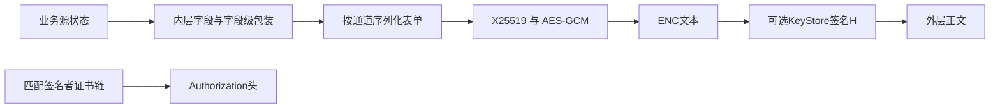
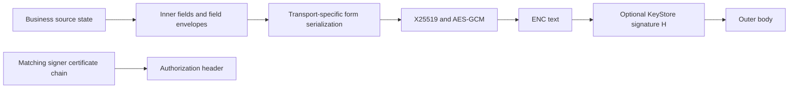

# Request Encryption · 参数序列化与加密封装

[注册目录](README.md#zh) · [中文](#zh) · [English](#en)

<a id="zh"></a>

## 中文

本页说明内层参数如何成为加密正文。字段自身的[安全包装](security-fields/README.md#zh)、外层 `ENC`、签名 `H` 与HTTP `Authorization` 分属不同层，不能互换密钥、编码或生命周期。



### 1. 内层值与编码身份

| 值类别 | 例子 | 处理 |
| --- | --- | --- |
| 普通文本 | cc、in、method | UTF-8与所选表单路径的转义 |
| JSON文本 | client_metrics、_ge、_ga | 先序列化内部JSON，再把它作为一个字符串字段 |
| 字段密文文本 | gpia、_gg、_gi | 保留各自标准Base64字母表与padding，再做表单处理 |
| Base64url文本 | authkey、e_ident、expid | 保持无padding表示；不是原始二进制的通用替代 |
| 原始二进制 | id、backup_token、foa_backup_token | 按字节百分号编码；Kotlin 构造器标记预编码身份，避免再次转义 |

缺键、null、空串、0和false不同。[exist明文示意](exist.md#plaintext-example)和[code明文示意](code.md#plaintext-example)均采用展示用字符串，不是可以整份发送的字典。恢复字段显示的 `%HH` 已代表原始字节；不能先对该显示文本再做一次百分号编码。

### 2. 序列化路径

Kotlin HTTP构造器以插入有序Map和“已预编码键”集合区分两类值。按插入顺序用 `&` 连接 `key=value`，不按名字排序；覆盖已有键保留原位置。key始终按Java `URLEncoder(...,"UTF-8")` 编码。

| 输入 | 普通URLEncoder值 | 原始字节预编码值 |
| --- | --- | --- |
| 空格 | `+` | `%20` |
| `*` | `*` | `%2A` |
| `~` | `%7E` | `~` |
| `+` | `%2B` | `%2B` |
| `0x00`字节 | 按文本编码路径处理 | `%00` |

原始字节预编码仅保留字母、数字和 `-._~`，其余用大写 `%HH`。构造器拼接已标记的值时不再URLEncoder。Base64url字段虽然通常没有需转义的字符，仍属于普通文本路径，不因此加入预编码集合。

原生WAMsys使用自己的typed dictionary与枚举布局，原始字节编码使用 `-._~` 安全集；恢复字段的预编码同样不能重复。最终枚举顺序由该容器状态决定，不应擅自排序、套用另一语言Map插入顺序或认定两个通道对所有字符都等价。语义相等的参数可以产生不同form字节；ENC和H依赖实际字节。

仅展示编码差异的例子：普通字段值 `a b*~` 成为 `note=a+b*%7E`；同样ASCII字节走预编码路径成为 `blob=a%20b%2A~`。预编码片段再转义会错误产生 `%2520`。

### 3. ENC

取新临时X25519密钥对，使用本通道服务器公钥求共享密钥。服务器公钥不是账户 `authkey`、Signal身份、HTTP签名证书公钥或任意别的通道输入。

```text
P = UTF8(serialized_form)
E_public32 = X25519_public(ephemeral_private32)
shared32 = X25519(ephemeral_private32, server_public32)
C || T16 = AES256-GCM(shared32, nonce=zero12, plaintext=P, AAD=empty)
ENC = Base64urlNoPadding(E_public32 || C || T16)
```

共享32字节直接作为AES256 key，没有额外SHA-256或HKDF。GCM tag为16字节，nonce12为零且不放入包络，AAD为空。内部若公钥格式为 `0x05 || public32`，输出只保留raw32；没有公钥长度前缀。整体原始包络长度为 `32 + len(P) + 16`。

每次重新构造加密包络使用新临时密钥；零nonce不能脱离这个条件复用到不同明文。[_gs.em](security-fields/gs.md#zh)虽然也使用X25519/GCM，其临时密钥、明文和peer输入边界独立，不能共享临时私钥来省一步。

### 4. H与证书

在正常加密且启用证明的分支，签名者先按实际alias、连接公共材料及刷新配置准备AndroidKeyStore密钥，再签名ENC文本本身：

```text
message = UTF8(ENC)              // 不含 "ENC="
H = Base64urlNoPadding(Signature(configured_algorithm, current_KeyStore_key, message))
```

在正常加密分支，`H`不是HMAC，也不直接签明文form或完整外层正文。算法由配置决定；采用 `SHA256withECDSA` 时签名字节为DER结构，长度可变，不固定为64字节。新签名可以验签相同message而字节不同，不能要求与旧H逐字相同。

`Authorization` 从匹配alias的证书数组逆序逐张取DER、无分隔拼接，再做标准Base64含padding：

```text
chain_bytes = DER(chain[n-1]) || ... || DER(chain[0])
Authorization = standard_Base64(chain_bytes)
```

没有 `Bearer ` 前缀，证书数量不是固定四张。逆序布局中的签名叶证书通常在末端，应按实际链确定；不能总拿头中第一张验H。编码正确或验签通过不等于完成了证书信任/attestation策略验证。

### 5. 配对与轮换

H与Authorization须绑定同一签名者、实际alias、算法与当前链。准备、签名、取链都可能受配置和刷新影响；刷新间隔不是证书有效期。生成过程可先删除旧entry再生成，期间失败不提供原子回滚。

签名前后重新检查alias、连接公共材料、算法、证书，并用相应叶公钥验签，可识别部分中途变化；这也不是所有并发状态的全局事务。若链轮换，应使用新H与新链配对，不固定旧Authorization，更不导出私钥来复现随机签名字节。

静态KeyStore准备的“保留已有entry”配置可跳过到期刷新；其它分支还按现有private-key算法与生成算法配置是否一致、刷新时间戳和间隔决定重建。缺entry仍可能创建，证书有效期与刷新间隔分别配置。生成尝试失败后，相关路径仍可能更新时间戳，不能仅凭timestamp变化认定新密钥已生成。签名与证书getter各自都可触发准备，并不构成一次原子快照。

上述签名前后复核和验签是配对校验措施，原生签名回调并不自动执行全部这些严格检查。WAMsys中的证书bytes还可先经异步桥保存到通道context；取当前签名与读取先前保存的链不保证发生在同一时刻。

### 6. 外层正文与失败分支

启用加密和证明时，成功分支的正文形状为：

```text
ENC=<Base64url文本>&H=<Base64url签名文本>
```

Kotlin body builder需区分加密开关、endpoint的sendAttestation分支和签名者内部开关。成功加密且endpoint分支不请求证明时只有ENC；endpoint分支请求证明但签名者内部关闭/不可用时，仍可写空H，而非自动切成ENC-only。

| 加密结果 | endpoint请求证明 | 正文形状 |
| --- | --- | --- |
| 成功 | 否 | `ENC=<enc>` |
| 成功 | 是 | `ENC=<enc>&H=<signature-or-empty>` |
| 未加密或加密失败回退 | 否 | 原始form query |
| 未加密或加密失败回退 | 是 | 原始form query加 `&H=<signature-or-empty>`；签名输入为该query |

此表说明Kotlin builder分支，不据此推定WAMsys具有同样降级行为。Base64url无padding本身适合ENC/H的form位置；最终仍以实际body builder的字节为准。`Content-Length` 对最终UTF-8正文取字节长度，不用内层字段数、form长度或字符显示长度代替。

签名返回null时存在写空 `H=` 的客户端失败路径，证书不可用时也可能无Authorization或为空；这些路径不说明服务端接受缺失证明。某些加密失败分支还可尝试对未加密query附签名，不能把这种回退说成正常ENC算法，或在独立实现里悄悄把加密错误降级成明文。

内层参数对象、最终序列化字节、加密包络、外层body与HTTP写入边界须分开。头部和响应处理见[发送流程](sending-requests.md#zh)，请求字段见[exist](exist.md#zh)与[code](code.md#zh)。

[返回注册目录](README.md#zh)

<a id="en"></a>

## English

This page explains how inner parameters become an encrypted body. [Field-level security envelopes](security-fields/README.md#en), outer `ENC`, signature `H`, and HTTP `Authorization` are separate layers with different keys, encodings, and lifetimes.



### 1. Values and Encoding Identity

| Category | Examples | Handling |
| --- | --- | --- |
| Ordinary text | cc, in, method | UTF-8 and the chosen form escaping |
| JSON text | client_metrics, _ge, _ga | Serialize internal JSON, then carry it as one string field |
| Field ciphertext text | gpia, _gg, _gi | Preserve standard Base64 alphabet/padding before form handling |
| Base64url text | authkey, e_ident, expid | Preserve unpadded text; not a universal replacement for raw bytes |
| Raw binary | id, backup_token, foa_backup_token | Byte-wise percent encoding; the Kotlin builder tracks preencoded identity to avoid a second escape |

Omission, null, empty text, 0, and false differ. Both the [exist field illustration](exist.md#plaintext-example-en) and [code field illustration](code.md#plaintext-example-en) use display strings, not one sendable dictionary for all flows. `%HH` in recovery examples already represents raw bytes; do not percent-encode that display text again.

### 2. Serialization Paths

The Kotlin HTTP builder uses an insertion-ordered Map and a set of preencoded keys. Join `key=value` pairs with `&` in insertion order, without name sorting; overwriting a key retains its position. Keys always use Java `URLEncoder(...,"UTF-8")`.

| Input | Ordinary URLEncoder value | Preencoded raw-byte value |
| --- | --- | --- |
| Space | `+` | `%20` |
| `*` | `*` | `%2A` |
| `~` | `%7E` | `~` |
| `+` | `%2B` | `%2B` |
| Byte `0x00` | Follow the text-encoding path | `%00` |

Raw-byte preencoding preserves only letters, digits, and `-._~`, using uppercase `%HH` otherwise. Marked values are appended without another URLEncoder pass. Base64url fields remain ordinary text, despite usually requiring no escaping; they are not thereby marked preencoded.

Native WAMsys has its own typed dictionary and enumeration layout, with the `-._~` raw-byte safe set and the same need to avoid double-encoding recovery material. Enumeration depends on container state: do not impose sorting, another language's insertion order, or universal character-level equivalence with Kotlin. Semantically equal parameters can yield different form bytes; ENC and H depend on actual bytes.

For illustration, ordinary `a b*~` yields `note=a+b*%7E`; those same ASCII bytes on the preencoded path yield `blob=a%20b%2A~`. Re-escaping that fragment incorrectly produces `%2520`.

### 3. ENC

Generate an ephemeral X25519 pair and agree with the selected transport's server public key. This key is not account `authkey`, Signal identity, the HTTP signing-certificate key, or an arbitrary other channel input.

```text
P = UTF8(serialized_form)
E_public32 = X25519_public(ephemeral_private32)
shared32 = X25519(ephemeral_private32, server_public32)
C || T16 = AES256-GCM(shared32, nonce=zero12, plaintext=P, AAD=empty)
ENC = Base64urlNoPadding(E_public32 || C || T16)
```

Use shared32 directly as the AES256 key, with no extra SHA-256/HKDF. GCM tag16 follows ciphertext; the implicit zero12 nonce is not transmitted, and AAD is empty. If an internal key representation is `0x05 || public32`, retain only raw32 in the output, without a length prefix. Raw envelope length is `32 + len(P) + 16`.

Every newly constructed envelope uses a fresh ephemeral key; the zero nonce is not reusable with different plaintext under a reused key. [_gs.em](security-fields/gs.md#en) also uses X25519/GCM but has separate ephemeral material, plaintext, and peer-input boundaries. Do not share private material to avoid generating another key.

### 4. H and Certificates

In the normal encrypted branch with attestation enabled, the signer prepares AndroidKeyStore material according to its actual alias, connection public material, and refresh configuration, then signs ENC text itself:

```text
message = UTF8(ENC)              // excludes "ENC="
H = Base64urlNoPadding(Signature(configured_algorithm, current_KeyStore_key, message))
```

In the normal encrypted branch, `H` is not HMAC and does not directly sign the plaintext form or whole outer body. Configuration determines the algorithm. With `SHA256withECDSA`, the signature is variable-length DER, not fixed 64 bytes. A fresh valid signature can differ byte-wise for the same message.

For `Authorization`, reverse the matching alias's certificate array, concatenate DER without separators, and use padded standard Base64:

```text
chain_bytes = DER(chain[n-1]) || ... || DER(chain[0])
Authorization = standard_Base64(chain_bytes)
```

No `Bearer ` prefix; no fixed four-certificate count. The signing leaf is normally at the end of this reversed layout, but follow the actual chain rather than always verifying H with the first encoded certificate. Correct encoding or signature verification is not complete trust/attestation-policy validation.

### 5. Pairing and Rotation

Bind H and Authorization to the same signer, actual alias, algorithm, and current chain. Preparation, signing, and chain reads can be affected by configuration/refresh; refresh interval differs from certificate validity. Generation can delete an old entry before creating its replacement, without atomic rollback on failure.

Rechecking alias, connection public material, algorithm, and certificates around signing and verifying with the corresponding leaf can detect some changes, not create a global transaction. After rotation, pair new H with the new chain. Do not freeze old Authorization or export private material to reproduce randomized signature bytes.

A static-key configuration can retain an existing entry without expiry refresh. Other branches examine private-key algorithm versus generation configuration, refresh timestamp, and interval before rebuilding. A missing entry can still be created, and certificate validity is configured separately. Some failed generation attempts still update the refresh timestamp; its change alone does not establish a new key. Signing and certificate getters can each run preparation, without an atomic snapshot.

The rechecks and verification above are pairing checks; the native signing callback does not automatically perform all these stricter checks. WAMsys certificate bytes can also be published asynchronously into a transport context, so signing now and reading a previously stored chain need not sample the same instant.

### 6. Outer Body and Failure Branches

A successful encrypted/attested branch has this shape:

```text
ENC=<Base64url text>&H=<Base64url signature text>
```

The Kotlin body builder has separate encryption, endpoint sendAttestation, and signer-internal gates. Successful encryption with no endpoint attestation uses only ENC. An endpoint requesting attestation can still write empty H when the signer is internally disabled/unavailable, rather than automatically switching to ENC-only.

| Encryption result | Endpoint requests attestation | Body shape |
| --- | --- | --- |
| Successful | No | `ENC=<enc>` |
| Successful | Yes | `ENC=<enc>&H=<signature-or-empty>` |
| Unencrypted or encryption-failure fallback | No | Original form query |
| Unencrypted or encryption-failure fallback | Yes | Original query plus `&H=<signature-or-empty>`; the signed message is that query |

This describes Kotlin-builder branches, not a claim of identical WAMsys fallback. Unpadded Base64url fits ENC/H form positions, but actual body-builder bytes remain authoritative. `Content-Length` counts final UTF-8 body bytes, not inner field count, form length, or displayed characters.

Client failure branches can write empty `H=` after null signing, or omit/empty Authorization after unavailable certificates. These do not establish server acceptance of missing proof. Some encryption-failure branches can append a signature to an unencrypted query; this is not normal ENC processing and should not be silently substituted for failed encryption in an independent implementation.

Keep the parameter object, final serialized bytes, encrypted envelope, outer body, and HTTP write distinct. See [sending](sending-requests.md#en) for headers/responses and [exist](exist.md#en)/[code](code.md#en) for field sets.

[Back to registration](README.md#en)
