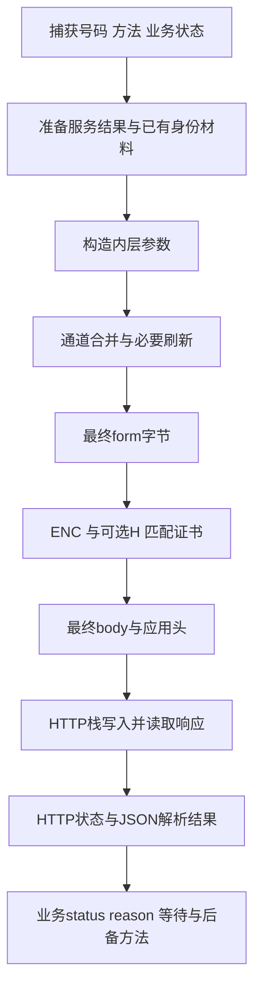
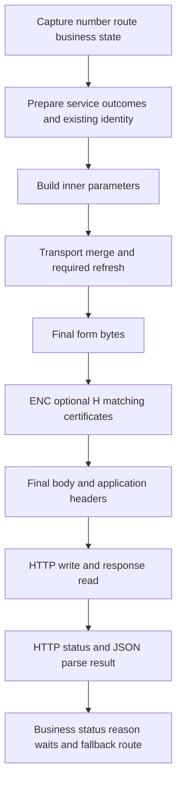

# Sending Requests · 发送流程与响应处理

[注册目录](README.md#zh) · [中文](#zh) · [English](#en) · [Telegram: @ttjjda](https://t.me/ttjjda)

<a id="zh"></a>

## 中文

注册请求在准备字段后还要经过合并、序列化、加密、签名、头部设置、正文写入与响应解释。业务任务、HTTP传输成功和注册完成不是一个状态。

### 1. 路线与通道

| 路线 | 业务用途 | 调度关系 |
| --- | --- | --- |
| `/v2/exist` | 号码检查 | [exist字段](exist.md#zh)；不提交验证码 |
| `/v2/code` | 申请当前验证方式 | [code字段](code.md#zh)；需保持号码/方式与状态一致 |
| `/v2/register` | 提交验证材料 | 根据实际验证路线与响应状态继续，不把code的sent当注册完成 |

Kotlin HTTP路径经bridge与可重试HTTP客户端；WAMsys路径通过原生请求和Java网络适配器，不经同一个Kotlin发送入口。Email/号码OTP的特定IQ路线又可能使用另一协议。因此endpoint同名、业务参数相似不表示正文、头或重试逻辑完全相同。

### 2. 正常发送顺序



异步准备期间保留本请求已捕获的号码/方式；不在恢复后把另一次页面输入混进来。`exist` 可在发出前写入后续code使用的备份偏好，尝试计数也可在最终HTTP之前递增；这不意味着请求已经成功发出。

原生exist可在通道合并时重新采集 `_gs`，以当前结果覆盖早先输入。最终form必须从最后合并后的字典生成，不能把JNI任务快照直接视为最终HTTP正文。具体[加密与签名规则](request-encryption.md#zh)决定后续每层字节。

### 3. 方法、正文和应用头

注册HTTP路径使用POST，常规主机为 `v.whatsapp.net`，路径由所选endpoint提供。逻辑服务名、实际连接地址与HTTP Host是不同量。HOST/PROXY地址替换分支可连接候选IP并保留原域名Host，不要求三者文本相同；TLS目标名称与校验按所选HTTP栈处理，地址替换本身不说明已完成正确验证。

| 项目 | 内容 | 范围 |
| --- | --- | --- |
| `Content-Type` | `application/x-www-form-urlencoded` | 所述注册form路径 |
| `Content-Length` | 最终body字节数 | 在ENC/H正文形成之后计算 |
| `Authorization` | 逆序DER链拼接的标准Base64 | 证明开关、当前签名者与实际链决定 |
| `User-Agent` | 应用/Android/设备声明 | 由UA组件生成并可缓存 |
| `request_token` | 大写UUID请求标识 | WAMsys/MCI路径加入；不是验证码/Play token |
| `WaMsysRequest` | `1` | WAMsys Java适配路径专用标志 |

WAMsys路径可先建立Authorization、Content-Type和Content-Length，再由请求包装层加request_token，Java适配器再设置User-Agent和WaMsysRequest。不能把这六项套成Kotlin或所有code请求的强制头。

UA形状可写成 `AppName/<app-version> Android/<release> Device/<manufacturer>-<model>`；应用名、资源/配置与设备字段按组件规则取得，部分字符会规约。缓存非null时可直接复用；改变一项外部源不保证现有owner的UA已更新。

Host、压缩协商、连接控制和传输分块等可能由HTTP栈生成。应用明确设置的头与最终TLS字节流不是同一个清单；不要把应用六头称为完整wire。

### 4. 响应有三层

| 层 | 判断 |
| --- | --- |
| 传输 | 是否得到HTTP状态、正常/错误流，读取是否完成 |
| 解析 | 是否取得可解析JSON以及本地解析/错误状态 |
| 业务 | JSON的status、reason、method、等待/下一路线等 |

Kotlin注册响应解析器直接处理HTTP层提供的JSON流，不增加一层与请求ENC对称的响应解密。2xx正常流有10MiB上限，非2xx错误流尽量解析JSON并有1MiB上限；这些限制属于该解析路径，不泛化到所有原生适配器。

HTTP200可以携带 `status=fail`；`code` 的 `status=sent` 只表发码阶段，不能证明用户已收到或完成register；`exist` 的 `status=ok`也不是完整注册。解析失败或空流保留为独立结果，不能伪造一个业务JSON来掩盖。

Kotlin HTTP错误映射如下；原始HTTP状态和JSON业务reason应与本地码分别保留。

| HTTP | 本地错误码 |
| --- | --- |
| 400 | 12 |
| 403 | 2 |
| 408 | -2 |
| 429 | 9 |
| 500、502、504 | -3 |
| 503 | 6 |
| 其它非成功情况 | -1 |

原生callback中的整数完成状态又属于通道接口，不能把其 `1` 直接当JSON字符串 `ok`，或与HTTP200互换。

该Kotlin解析器在2xx且JSON解析成功时返回本地码0、成功标记true，即便JSON业务status为fail；2xx解析异常保留实际HTTP码，但JSON为null、本地码-1、成功标记false。非2xx即便读到合法错误JSON，成功标记仍为false。该标记是下一层网络重试判断的一部分，不等于注册业务结果。

SocketTimeoutException被发送包装映射为本地-2，ConnectException/IOException以及相关通用Exception失败可为-1；无HTTP响应时不填造HTTP200。

### 5. 等待、重试与后备方法

`retry_after`、`sms_wait`、`voice_wait`、`flash_wait`、`next_method` 等属于响应业务状态。网络栈尝试另一主机/IP/代理、重新发起业务code、切换验证方式是三种动作，不用一个统一重试计数代表。是否可重试、何时重建字段与证明材料，由所选通道和上层状态决定，不给所有路线套固定次数或固定超时。

请求超时或连接断开不证明服务端未执行；结果不确定时不能仅因本地没收到响应就当作零次申请。另一个独立发码尝试会涉及新的业务计数和时效状态，不能靠重复序列化来模拟或规避。重定向也须按实际客户端策略处理，不把跳转页面自动解释为业务成功。

Google阶段的[gpia超时](security-fields/gpia.md#zh)、网络通知合并的500ms和HTTP读写超时是不同计时范围。异步协程可跨线程恢复，本次请求关联不能只靠最初线程；发出一个准备状态或保存最近method不等于HTTP写入完成。

#### Kotlin客户端的具体attempt规则

本Kotlin调度器最多选择4个attempt条目，包含首次ORIGINAL；候选耗尽或不可重试错误可更早结束，不保证4次网络写入。本入口先选择ORIGINAL；其HOST/PROXY候选列表构造时为空，后续可用候选来自传入的DOMAIN_FRONTING列表。fronting项须可解析为三段非空配置才进入候选；不能仅因存在地址替换分支就假设本次有IP候选。

解析成功标记true会立即结束网络重试，包括HTTP200携带业务fail。标记false时，本地码2、5、7、12直接结束；其它码继续选候选，包含HTTP429映射的9。这个分支不等于自动按业务retry_after等待或重新跑发码流程，也不应推广到WAMsys。

第n个attempt（n>1）在执行前使用随机抖动退避：

```text
delay_ms = clamp(toLong(random_double * (n*n - 1) * 4 * 1000), 0, 60000)
```

这是该Kotlin调度器的0..60000ms协程等待，不是固定间隔或所有请求共用的指数策略。DOMAIN_FRONTING按配置模板替换PATH/QS，并设置配置Host与原逻辑域名的X-Forwarded-Host；与HOST/PROXY替换不是同一分支。

重试保留同一个参数构造器及预编码键集合；每次实际进入body builder可重新序列化并生成新ENC/H，但不因此重新执行上游UI、Google或业务计数producer。字段复用与加密/签名重建须分别理解。


### 6. 保持关联和解释边界

每个请求应把业务号码/方式、最终内层值、序列化form、ENC、H、匹配证书、实际应用头、写入body及对应响应关联到同一个请求上下文。签名或链中途变化要按[配对规则](request-encryption.md#zh)处理，不沿用另一实例或过期链。

读取响应流会消费它；HTTP层响应对象、解析后的JSON和原始流是不同表示。对比时既可比较解析对象，也应区分嵌套challenge等动态字段；去掉动态字段后的相等不等于原始body逐字相等。服务端对各安全字段的逐项校验和路由决策不能由一次业务成功推出。

相关：[注册目录](README.md#zh)、[安全字段](security-fields/README.md#zh)、[参数封装](request-encryption.md#zh)。

[返回注册目录](README.md#zh)

<a id="en"></a>

## English

After fields are prepared, registration still involves merging, serialization, encryption, signing, headers, body writes, and response interpretation. Business-task completion, HTTP success, and completed registration are different states.

### 1. Routes and Transports

| Route | Purpose | Relationship |
| --- | --- | --- |
| `/v2/exist` | Number checking | [exist fields](exist.md#en); does not submit a verification code |
| `/v2/code` | Request the selected verification route | [code fields](code.md#en); keep number/route and state consistent |
| `/v2/register` | Submit verification material | Follow the actual verification route and response; code sent is not registration completion |

The Kotlin HTTP route uses a bridge and retry-capable client. WAMsys uses native requests and a Java network adapter, bypassing that Kotlin sending entry. Particular email/number OTP IQ routes can use another protocol. Similar endpoints or business fields do not establish identical bodies, headers, or retry logic.

### 2. Normal Sending Order



Preserve captured number/route through asynchronous preparation; do not mix later UI input into a suspended request. `exist` can persist backup material for later code and increment attempts before HTTP transmission; neither action establishes a successful send.

Native exist can recollect `_gs` during transport merging and overwrite earlier input. Build the final form from the final merged dictionary rather than equating a JNI task snapshot with the HTTP body. [Encryption/signature rules](request-encryption.md#en) determine subsequent bytes.

### 3. Method, Body, and Application Headers

Registration HTTP uses POST, normally with host `v.whatsapp.net` and the chosen endpoint path. Logical service name, connection address, and HTTP Host are distinct. HOST/PROXY substitution can connect to a candidate IP while retaining the original-domain Host; the three strings need not match. TLS target naming/verification follows the chosen HTTP stack, and address substitution alone does not establish correct verification.

| Item | Contents | Scope |
| --- | --- | --- |
| `Content-Type` | `application/x-www-form-urlencoded` | The described registration form paths |
| `Content-Length` | Final body byte count | Calculated after ENC/H body construction |
| `Authorization` | Standard Base64 of reversed concatenated certificate DER | Attestation gate, current signer, and actual chain |
| `User-Agent` | Application/Android/device declaration | Generated and cacheable by its component |
| `request_token` | Uppercase request UUID | Added on WAMsys/MCI; not a verification code or Play token |
| `WaMsysRequest` | `1` | WAMsys Java-adapter marker |

WAMsys can establish Authorization, Content-Type, and Content-Length first; its wrapper adds request_token, then the Java adapter sets User-Agent and WaMsysRequest. These six are not mandatory headers for Kotlin or every code request.

UA can have shape `AppName/<app-version> Android/<release> Device/<manufacturer>-<model>`. Its component reads application branding/resources/configuration and device fields, normalizing certain characters. A non-null cache can be reused; changing an external source does not necessarily refresh the owner's UA.

HTTP stacks can generate Host, compression negotiation, connection control, and transfer framing. Explicit application headers are not the final TLS byte inventory; six application headers are not complete wire data.

### 4. Three Response Layers

| Layer | Question |
| --- | --- |
| Transport | Was an HTTP status/normal or error stream obtained, and did reading complete? |
| Parsing | Was JSON parsed, with what local parse/error state? |
| Business | What do status, reason, method, waits, and next-route fields say? |

The Kotlin registration parser reads JSON provided by the HTTP layer, without an extra response-decryption step symmetrical to request ENC. The 2xx normal stream has a 10 MiB bound; the non-2xx error stream is parsed as JSON where possible with a 1 MiB bound. These are limits of that parser, not every native adapter.

HTTP 200 can contain `status=fail`. `status=sent` for code describes only the request-code stage, not confirmed receipt or completed register. `status=ok` for exist is not full registration either. Keep parse failure or empty streams separate rather than inventing business JSON.

Kotlin HTTP error mapping follows this table. Preserve raw HTTP status and business reason separately from local codes.

| HTTP | Local error code |
| --- | --- |
| 400 | 12 |
| 403 | 2 |
| 408 | -2 |
| 429 | 9 |
| 500, 502, 504 | -3 |
| 503 | 6 |
| Other unsuccessful cases | -1 |

An integer native-callback completion result is another transport-interface value. Do not equate its 1 with JSON string `ok` or HTTP 200.

For this Kotlin parser, 2xx with parsed JSON returns local code 0/success true even when business status is fail. A 2xx parse exception retains the HTTP code but yields null JSON, local -1, and success false. Non-2xx remains success false even with valid error JSON. This flag participates in network-retry decisions, not registration-business success.

The send wrapper maps SocketTimeoutException to local -2; ConnectException/IOException and related generic Exception failures can map to -1. No HTTP response does not justify inventing HTTP 200.

### 5. Waiting, Retries, and Fallback Methods

`retry_after`, `sms_wait`, `voice_wait`, `flash_wait`, and `next_method` are business response state. Retrying a host/IP/proxy, beginning another code attempt, and changing verification routes are different actions, not one universal retry count. The chosen transport and upper-level state govern retry eligibility and rebuilding of fields/proofs; there is no fixed count or timeout to impose on every route.

Timeout/disconnection does not establish that the server did nothing. An uncertain result is not automatically zero attempts. A new business attempt affects counters and freshness; serializing again does not simulate or bypass that boundary. Follow the actual redirect policy rather than treating a destination page as business success.

The [gpia timeout](security-fields/gpia.md#en), 500 ms network-notification coalescing, and HTTP read/write timeouts cover different intervals. Coroutines can resume on different threads, so the initial thread alone is not request correlation. A preparation event or saved last method is not completed HTTP writing.

#### Concrete Kotlin Attempt Rules

This Kotlin scheduler selects at most 4 attempt entries including the initial ORIGINAL. Exhausted candidates or nonretryable errors can stop earlier; this does not promise 4 network writes. This entry selects ORIGINAL first, constructs empty HOST/PROXY candidate lists, and obtains later available candidates from its supplied DOMAIN_FRONTING list. Fronting entries must parse into three nonblank parts to become candidates. Address-substitution code alone does not establish an IP candidate for this invocation.

A true parsed-success flag immediately stops network retries, including HTTP 200 with business fail. With a false flag, local codes 2, 5, 7, 12 stop; other codes continue candidate selection, including local code 9 for HTTP 429. This is not automatic business retry_after handling or a new code-generation flow, and does not define WAMsys policy.

Before attempt n>1, the scheduler applies randomized backoff:

```text
delay_ms = clamp(toLong(random_double * (n*n - 1) * 4 * 1000), 0, 60000)
```

This is the Kotlin scheduler’s 0..60000 ms coroutine wait, not a fixed interval or universal exponential policy. DOMAIN_FRONTING substitutes PATH/QS into its configured template and sets configured Host plus original logical-domain X-Forwarded-Host; it differs from HOST/PROXY substitution.

Retries retain the same parameter builder and preencoded-key set. Each body-builder execution can serialize again and generate fresh ENC/H without rerunning upstream UI, Google, or business-counter producers. Field reuse and encryption/signature rebuilding are separate.


### 6. Correlation and Interpretation

Associate the business number/route, final inner fields, form, ENC, H, paired certificates, actual application headers, written body, and response with the same request context. Handle signing/chain changes through the [pairing rules](request-encryption.md#en), not another instance or an old chain.

Reading a response stream consumes it. HTTP response objects, parsed JSON, and raw streams are different representations. Comparisons can inspect parsed objects but must distinguish dynamic nested challenges: equality after removing such a field is not raw-body equality. One successful outcome does not establish how the server validates each security field or selects a route.

Related: [registration](README.md#en), [security fields](security-fields/README.md#en), [packaging](request-encryption.md#en).

[Back to registration](README.md#en)
